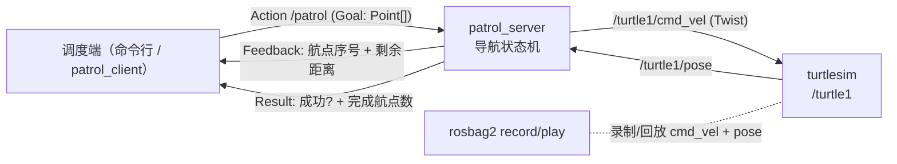

# 海龟夜间巡逻系统（Patrolling Little Turtle）项目实现流程文档

| 项目项 | 内容 |
| --- | --- |
| 文档版本 | v1.0（正式执行版） |
| 文档状态 | 可执行基线，可直接指导开发 |
| 项目名称 | 海龟夜间巡逻系统（Patrolling Little Turtle） |
| 代码仓库 | `/home/wxx/my_project/Patrolling-little-turtle` |
| 目标平台 | Ubuntu 22.04.5 LTS + ROS 2 Humble |
| 技术栈 | Python 3.10 / rclpy / ROS 2 Action / turtlesim / rosbag2 / launch |
| 需求来源 | 项目背景、需求清单 R1-R6、验收标准（功能验收 + 代码验收）、建议开发顺序、挑战加分项 |
| 计划周期 | 10 个工作日（含 1 天缓冲），可按 5 日冲刺压缩，但不得跳过阶段门禁 |
| 文档维护 | 开发负责人；接口或验收口径变更时必须同步修订本文档 |
| 最后更新 | 2026-10-28 |

> 阅读方式：第 1-3 章回答“做什么、为什么这样做”；第 4-7 章回答“按什么顺序做、每步交付什么”；第 8-13 章是开发与联调的执行规范；第 14 章是本文档的自查与修正记录。所有阶段均以“交付物 + 验收门禁”推进，未通过门禁不得进入下一阶段。

## 目录

1. 项目概述与需求追溯
2. 系统架构与关键设计决策
3. 技术选型说明
4. 依赖与环境配置步骤
5. 仓库结构与工程骨架
6. 阶段划分、里程碑与时间节点
7. 各阶段详细任务、交付物与验收标准
8. 接口契约规范（Action / 话题 / 参数 / 日志）
9. 核心算法与控制设计
10. 联调要求与故障排查
11. 测试标准与验收用例
12. 部署、交付与运行手册
13. 风险登记册
14. 自查报告与修正记录
15. 附录（命令速查、提交规范、变更记录）

---

## 1. 项目概述与需求追溯

### 1.1 项目背景

在一家机器人公司入职第一周，接到导师任务：为一台差速底盘小车（turtlesim 中的海龟）开发一个**可配置、可监控、可复盘**的巡逻系统，用于夜间仓库安防巡逻。调度端（测试阶段由命令行代替）向小车下发“按顺序经过一组航点”的任务；系统需要实时反馈进度、支持随时取消并安全停车、支持通过参数更换路线与速度、支持一条命令启动、支持录制与回放整轮巡逻数据。

### 1.2 建设目标

交付一个可演示、可复查、可扩展的 ROS 2 小型系统，具备以下六项能力：

| 能力 | 目标描述 | 对应需求 |
| --- | --- | --- |
| 任务下发 | 通过 ROS 2 Action 下发有序航点列表，服务端逐个执行 | R1、R2、R3 |
| 进度可视 | Feedback 与客户端终端实时显示“第几个航点 + 剩余距离” | R1、R3 |
| 可取消 | 巡逻中取消，海龟立即安全停止（零速），客户端收到取消结果 | R2、R3 |
| 可配置 | 速度、航点列表均由参数提供，换路线不改代码 | R4、R5 |
| 一键启动 | 一条 `ros2 launch` 启动 turtlesim + server + client | R5 |
| 可复盘 | rosbag 录制 `/turtle1/cmd_vel` 与 `/turtle1/pose`，离线回放 | R6 |

### 1.3 交付形态

- 一个 ROS 2 工作区（仓库根目录即工作区，源码位于 `src/`）。
- 两个功能包：`my_turtle_interfaces`（接口包，ament_cmake）与 `my_turtle_pkg`（实现包，ament_python）。
- 一个 Action 接口：`my_turtle_interfaces/action/Patrol.action`。
- 两个可执行节点：`patrol_server`、`patrol_client`。
- 一个一键 Launch：`patrol.launch.py`。
- 一份参数配置：`config/patrol_params.yaml`。
- 一组测试：纯函数单元测试 + 现场验收用例。
- 一组复盘证据：录制 bag、`ros2 bag info` 输出、回放录屏/截图、验收记录。
- 本文档与 README 运行手册。

### 1.4 范围与非目标

**范围内：**

- turtlesim 仿真环境下的单海龟巡逻。
- Action 接口设计、服务端导航控制、客户端调度与监控。
- 参数化、Launch 编排、rosbag2 录制回放。
- 基础异常处理、取消语义、测试与验收。

**范围外（本期不做，避免过度设计）：**

- 真实底盘驱动、里程计标定、SLAM、避障、Nav2 路径规划。
- Web/可视化调度平台、数据库任务队列、多机协同。
- 多海龟编队（仅作为可选加分项，且必须保留单龟基线）。
- 跨网络部署、容器化与 systemd 守护（仅在部署章节给出可选建议）。

### 1.5 术语表

| 术语 | 含义 |
| --- | --- |
| 航点（Waypoint） | turtlesim 世界坐标系下的二维目标点 `(x, y)`，单位米 |
| Action | ROS 2 的“目标-反馈-结果”长任务通信机制，支持取消 |
| Goal / Feedback / Result | 任务目标 / 过程反馈 / 最终结果 |
| 到达容差（tolerance） | 判定“已到达航点”的距离阈值，默认 0.15 m |
| 航向容差 | 判定“已对准目标方向”的角度阈值，默认 0.10 rad |
| 零速 Twist | `linear.x=0, angular.z=0` 的速度指令，用于安全停车 |
| 单写者原则 | 同一时刻只允许一个执行线程向 `/turtle1/cmd_vel` 发布指令 |
| 执行器（Executor） | rclpy 的回调调度器；本系统使用多线程执行器 |
| 回调组（Callback Group） | 控制回调并发关系的机制；本系统使用可重入回调组 |
| bag | rosbag2 录制文件，包含带时间戳的话题消息 |

### 1.6 需求追溯矩阵

| 需求 ID | 需求摘要 | 设计/实现载体 | 开发阶段 | 验收用例 |
| --- | --- | --- | --- | --- |
| R1 | 定义 `Patrol.action`：Goal 为 `geometry_msgs/Point[]`；Feedback 含当前航点与剩余距离；Result 含是否完成与实际走过航点数 | `my_turtle_interfaces/action/Patrol.action` | P1 | TC-02、TC-03、TC-11 |
| R2 | `patrol_server` 逐航点执行“转向→直行→到达判定”，分段反馈，支持取消（零速后返回） | `patrol_server.py`、`patrol_math.py` | P2、P3、P4 | TC-03、TC-05、TC-06 |
| R3 | `patrol_client` 启动后自动下发默认航点，打印每条反馈；Ctrl+C 或参数超时主动取消 | `patrol_client.py` | P1、P4 | TC-04、TC-05、TC-12、TC-18 |
| R4 | 巡逻线速度/角速度、默认航点列表声明为参数并带默认值 | `patrol_params.yaml` + `declare_parameter` | P5 | TC-07、TC-08 |
| R5 | `patrol.launch.py` 一键启动三节点，并通过 Launch 参数传入慢速/快速两套速度 | `launch/patrol.launch.py` | P5 | TC-01、TC-08 |
| R6 | rosbag 录制一轮 `/turtle1/cmd_vel` + `/turtle1/pose`，回放验证轨迹可复现 | rosbag2 命令与运行手册 | P6 | TC-09、TC-10 |

**原始验收条目 → 测试用例映射：**

| 验收条目 | 用例 |
| --- | --- |
| `ros2 launch my_turtle_pkg patrol.launch.py` 一条命令跑起完整系统 | TC-01 |
| 海龟依次走过 ≥3 个航点，轨迹目测贴合航点连线 | TC-03、TC-17 |
| client 终端实时打印“前往航点 2/4，剩余 1.3 m”类进度 | TC-04 |
| 中途取消，海龟立刻停止（不是原地打转），client 收到取消确认 | TC-05、TC-06 |
| `ros2 param set` 改速度后巡逻快慢肉眼可见变化 | TC-07 |
| bag 用 `ros2 bag info` 看到两个话题，`ros2 bag play` 能重演轨迹 | TC-09、TC-10 |
| `.action` 位于 `my_turtle_interfaces`，改接口后重新 `colcon build` 通过 | TC-11、CR-01 |
| 角度差归一化，跨 ±π 不绕路 | UT-01、TC-13 |
| 取消处理发过零速 Twist 再返回结果 | TC-06、CR-03 |
| 没有 `time.sleep()` 式阻塞轮询 | CR-04 |
| 节点用 `get_logger()` 输出关键事件 | CR-05 |
| 两个新节点注册进 `setup.py` 的 `entry_points` | TC-11、CR-06 |

---

## 2. 系统架构与关键设计决策

### 2.1 逻辑架构



**运行视图：**

| 进程/节点 | 职责 | 关键接口 |
| --- | --- | --- |
| `turtlesim_node` | 仿真差速海龟，发布位姿、订阅速度 | 发布 `/turtle1/pose`；订阅 `/turtle1/cmd_vel` |
| `patrol_server` | 接收 Action 目标，执行逐航点导航，发布反馈与结果 | Action Server `/patrol`；订阅 `/turtle1/pose`；发布 `/turtle1/cmd_vel` |
| `patrol_client` | 构造并下发默认航点，打印反馈，处理取消与超时 | Action Client `/patrol` |
| `ros2 bag record` | 录制 `cmd_vel` 与 `pose` | 话题录制 |
| `ros2 bag play` | 回放录制数据，复现轨迹 | 话题回放 |

### 2.2 启动、执行、取消、回放时序

**启动时序：**

1. `ros2 launch my_turtle_pkg patrol.launch.py` 启动 `turtlesim_node`、`patrol_server`、`patrol_client`。
2. `patrol_server` 创建 Action Server、订阅 `/turtle1/pose`、创建 `/turtle1/cmd_vel` 发布者。
3. `patrol_client` 以 10 Hz 定时器检测 `server_is_ready()`，就绪后立即发送默认航点目标，避免启动竞态。
4. 服务端收到目标后校验航点列表，等待首帧位姿（最多 `pose_timeout` 秒），随后进入控制循环。

**执行时序：**

1. 服务端对每个航点执行：读取位姿 → 计算航向误差 → 原地转向 → 直行并微调航向 → 到达判定。
2. 控制循环 20 Hz 发布 `Twist`；反馈节流为 5 Hz，包含当前航点序号、剩余总距离、距当前目标距离。
3. 到达当前航点后计数加一，进入下一航点；全部完成后发布零速，返回成功结果。

**取消时序：**

1. 客户端调用 `cancel_goal_async()`；服务端 `cancel_callback` 接受取消。
2. 控制循环在下一个周期（≤50 ms）检测到取消，发布零速 `Twist`，随后调用 `goal_handle.canceled()` 返回结果。
3. 客户端收到结果状态 `STATUS_CANCELED`，打印“已取消 + 已完成航点数”，视为取消确认。

**回放时序：**

1. 停止在线 `patrol_server` 与 `patrol_client`，避免与 bag 同时向 `/turtle1/cmd_vel` 发布。
2. 重置 turtlesim 至默认位姿，确保初始状态与录制时一致。
3. `ros2 bag play` 回放；turtlesim 订阅回放的 `cmd_vel` 复现运动，`pose` 仅用于观察/分析。

### 2.3 关键设计决策（ADR）

| 编号 | 决策 | 理由 | 代价/约束 |
| --- | --- | --- | --- |
| ADR-01 | 用 ROS 2 Action，而非 Service/Topic 组合 | Action 原生支持长任务、过程反馈、取消与结果，正好覆盖 R1-R3 | 需要定义 `.action` 并重建接口包 |
| ADR-02 | 使用 Python + rclpy，而非 C++ | 项目规模小、迭代快、验收以功能与代码规范为主 | 控制频率上限不高，本场景 20 Hz 足够 |
| ADR-03 | 控制闭环放在服务端，客户端只做下发与观察 | 职责单一；调度端退出不应导致控制逻辑丢失 | 服务端需处理位姿、控制、取消并发 |
| ADR-04 | 速度参数归 `patrol_server`，默认航点参数归 `patrol_client` | 谁使用谁声明，避免参数跨节点隐式耦合 | Launch 需把同一 YAML 分发给两个节点 |
| ADR-05 | 使用 `MultiThreadedExecutor` + `ReentrantCallbackGroup` | 阻塞式 `execute_callback` 与位姿订阅、取消、参数回调必须并发 | 必须遵守单写者与线程安全约定 |
| ADR-06 | 航点配置放 YAML 参数文件，Launch 只做覆盖 | 换路线改配置即可，不重新编译 | 航点运行时修改只对新目标生效 |
| ADR-07 | rosbag2 使用默认 sqlite3 存储 | Humble 默认可用，无需额外插件 | 数据量大时再考虑 mcap |
| ADR-08 | 单目标串行执行，基线拒绝并发目标 | 两个目标同时控制同一海龟会产生速度指令冲突，安全风险高 | 加分项再实现“抢占”语义 |

---

## 3. 技术选型说明

| 类别 | 选型 | 版本基线 | 用途 | 选择理由 | 主要替代方案 |
| --- | --- | --- | --- | --- | --- |
| 操作系统 | Ubuntu | 22.04.5 LTS | 运行环境 | 与 ROS 2 Humble 官方二进制包匹配，当前机器已满足 | Ubuntu 24.04 + Jazzy |
| ROS 2 | Humble Hawksbill | 已安装（`/opt/ros/humble`） | 通信中间件与工具链 | LTS、生态稳定、当前环境现成 | Jazzy（需改部分 API/包名） |
| 客户端库 | rclpy | 3.3.x | Python 节点开发 | 开发效率高，Action/参数/Launch API 完整 | rclcpp |
| 仿真器 | turtlesim | 1.4.3 | 差速海龟仿真 | 轻量、确定性好、位姿与速度话题标准 | Gazebo、Stage |
| 接口定义 | rosidl + `.action` | Humble 自带 | 生成 Action 类型 | 标准做法，支持 `geometry_msgs/Point[]` | 自定义 msg + 服务组合 |
| 接口包构建 | ament_cmake | Humble 自带 | 生成 ROS 接口 | rosidl 生成器要求 CMake 包 | ament_python（不适合生成接口） |
| 节点包构建 | ament_python | Humble 自带 | Python 节点打包 | 目录简单、`entry_points` 注册可执行文件 | ament_cmake + Python |
| 构建工具 | colcon | 已安装 | 工作区构建与测试 | ROS 2 标准工具 | catkin（ROS 1，不适用） |
| 启动编排 | launch / launch_ros | Humble 自带 | 一键启动与参数分发 | 官方编排方案，支持条件与参数覆盖 | 手写 shell 脚本（不适合参数化） |
| 录制回放 | rosbag2 | 0.15.x | 录制/回放话题 | 标准工具，`info/play` 满足验收 | 自定义 CSV 记录 |
| 测试 | pytest + colcon test | python3-pytest | 纯函数单元测试 | 轻量，适合角度归一化/距离计算 | gtest（C++） |
| 代码规范 | PEP 8 + ament_flake8（可选） | Humble 自带 | 静态检查 | 与 ROS 2 Python 风格一致 | ruff（可选增强） |

**选型结论：**

- 以 Humble 为唯一基线，避免跨发行版 API 差异；若后续迁移 Jazzy，需验证 `rclpy.action`、`launch` 与 `turtlesim` 行为，本文档的接口契约不变。
- 不引入 Nav2、行为树、数据库等重组件：当前需求是“固定航点顺序巡逻”，状态机 + Action 足够，引入重组件会掩盖核心考点。
- 控制频率 20 Hz 是精度与资源占用的平衡点：1.5 m/s 下单周期位移 0.075 m，小于默认到达容差 0.15 m，避免高速穿越航点。

---

## 4. 依赖与环境配置步骤

### 4.1 前置检查（P0 执行）

```bash
lsb_release -ds
# 期望：Ubuntu 22.04.x LTS

ls /opt/ros
# 期望：包含 humble

python3 --version
# 期望：Python 3.10.x

colcon version-check 2>/dev/null || colcon --help >/dev/null && echo "colcon ok"
```

当前机器实测：Ubuntu 22.04.5、Python 3.10.12、`/opt/ros/humble` 已安装、`colcon` 可用。

### 4.2 安装与校验依赖

若上述检查发现缺失，执行：

```bash
sudo apt update
sudo apt install -y \
  ros-humble-turtlesim \
  ros-humble-rosbag2 \
  ros-humble-rosbag2-storage-default-plugins \
  ros-humble-launch-ros \
  python3-colcon-common-extensions \
  python3-pytest

source /opt/ros/humble/setup.bash
```

校验命令：

```bash
source /opt/ros/humble/setup.bash
ros2 pkg executables turtlesim          # 应看到 turtlesim_node
ros2 pkg prefix rosbag2                 # 应输出 /opt/ros/humble
ros2 bag --help >/dev/null && echo "rosbag2 ok"
ros2 interface show geometry_msgs/msg/Point
```

**依赖版本记录（写入交付物）：**

| 依赖 | 版本/来源 | 校验方式 |
| --- | --- | --- |
| ROS 2 Humble | `/opt/ros/humble` | `ls /opt/ros` |
| turtlesim | 1.4.3 | `ros2 pkg xml turtlesim` 查 `<version>` |
| rosbag2 | 0.15.17 | `ros2 pkg xml rosbag2` |
| rclpy | 3.3.22 | `ros2 pkg xml rclpy` |
| Python | 3.10.12 | `python3 --version` |
| colcon | 已安装 | `colcon --help` |

### 4.3 创建工作区与仓库

仓库根目录即工作区，源码放 `src/`：

```bash
cd /home/wxx/my_project/Patrolling-little-turtle
mkdir -p src docs bags scripts
```

`.gitignore` 至少包含：

```gitignore
build/
install/
log/
bags/
__pycache__/
*.py[cod]
.pytest_cache/
.vscode/
```

Git 基线：

```bash
git add .gitignore README.md docs/
git commit -m "chore: 初始化工作区与实现流程文档"
```

### 4.4 环境使用规则

1. 每打开一个新终端，先执行：
   ```bash
   source /opt/ros/humble/setup.bash
   source /home/wxx/my_project/Patrolling-little-turtle/install/setup.bash
   ```
2. 首次构建前只需 source ROS 环境；构建后再 source 工作区。
3. 修改 `.action` 后必须重建接口包，且重新 source，否则 Python 侧仍使用旧类型。
4. 多机/多终端联调时统一设置 `ROS_DOMAIN_ID`（例如 42），避免与其他 ROS 进程串扰：
   ```bash
   export ROS_DOMAIN_ID=42
   ```
5. 不建议在 `~/.bashrc` 中永久 source 工作区 `install/setup.bash`，避免旧构建产物污染新终端；在运行手册中显式 source。

### 4.5 P0 交付物与门禁

| 项 | 内容 |
| --- | --- |
| 交付物 | 环境检查记录、依赖版本表、`.gitignore`、仓库目录、初始提交 |
| 验收标准 | 四条校验命令全部通过；`git status` 干净；`docs/` 已纳入版本管理 |
| 时间节点 | D1 上午（0.5 天） |
| 门禁 | G0：环境不可用则停止后续开发，先修复环境 |

---

## 5. 仓库结构与工程骨架

### 5.1 目标目录树

```text
Patrolling-little-turtle/
├── src/
│   ├── my_turtle_interfaces/
│   │   ├── action/
│   │   │   └── Patrol.action
│   │   ├── CMakeLists.txt
│   │   └── package.xml
│   └── my_turtle_pkg/
│       ├── my_turtle_pkg/
│       │   ├── __init__.py
│       │   ├── patrol_math.py
│       │   ├── patrol_server.py
│       │   └── patrol_client.py
│       ├── launch/
│       │   └── patrol.launch.py
│       ├── config/
│       │   └── patrol_params.yaml
│       ├── resource/
│       │   └── my_turtle_pkg
│       ├── test/
│       │   └── test_patrol_math.py
│       ├── package.xml
│       ├── setup.py
│       └── setup.cfg
├── docs/
│   └── 项目实现流程文档.md
├── bags/                 # 录制产物，不纳入 Git
├── scripts/              # 可选：冒烟测试/轨迹对比脚本
├── .gitignore
└── README.md             # 运行手册摘要
```

### 5.2 接口包骨架（`my_turtle_interfaces`）

`action/Patrol.action`：

```text
# Goal：按顺序经过的航点列表（turtlesim 世界坐标，单位 m）
geometry_msgs/Point[] waypoints
---
# Result：任务最终结果
bool success
int32 waypoints_completed
string message
---
# Feedback：执行过程反馈
int32 current_index
int32 total_waypoints
float32 distance_to_target
float32 distance_remaining
```

`CMakeLists.txt` 关键内容：

```cmake
cmake_minimum_required(VERSION 3.8)
project(my_turtle_interfaces)

find_package(ament_cmake REQUIRED)
find_package(rosidl_default_generators REQUIRED)
find_package(geometry_msgs REQUIRED)

rosidl_generate_interfaces(${PROJECT_NAME}
  "action/Patrol.action"
  DEPENDENCIES geometry_msgs
)

ament_package()
```

`package.xml` 关键内容：

```xml
<buildtool_depend>ament_cmake</buildtool_depend>
<build_depend>rosidl_default_generators</build_depend>
<exec_depend>rosidl_default_runtime</exec_depend>
<depend>geometry_msgs</depend>
<member_of_group>rosidl_default_generators</member_of_group>
```

### 5.3 节点包骨架（`my_turtle_pkg`）

`setup.py` 关键内容（包含可执行入口与安装资源）：

```python
from glob import glob
import os
from setuptools import setup

package_name = 'my_turtle_pkg'

setup(
    name=package_name,
    version='0.1.0',
    packages=[package_name],
    data_files=[
        ('share/ament_index/resource_index/packages',
         ['resource/' + package_name]),
        ('share/' + package_name, ['package.xml']),
        (os.path.join('share', package_name, 'launch'), glob('launch/*.launch.py')),
        (os.path.join('share', package_name, 'config'), glob('config/*.yaml')),
    ],
    install_requires=['setuptools'],
    tests_require=['pytest'],
    entry_points={
        'console_scripts': [
            'patrol_server = my_turtle_pkg.patrol_server:main',
            'patrol_client = my_turtle_pkg.patrol_client:main',
        ],
    },
)
```

`setup.cfg`：

```ini
[develop]
script_dir=$base/lib/my_turtle_pkg
[install]
install_scripts=$base/lib/my_turtle_pkg
```

`package.xml` 依赖：

```xml
<exec_depend>rclpy</exec_depend>
<exec_depend>geometry_msgs</exec_depend>
<exec_depend>turtlesim</exec_depend>
<exec_depend>my_turtle_interfaces</exec_depend>
<exec_depend>launch</exec_depend>
<exec_depend>launch_ros</exec_depend>
<test_depend>python3-pytest</test_depend>
<export>
  <build_type>ament_python</build_type>
</export>
```

### 5.4 构建命令

```bash
cd /home/wxx/my_project/Patrolling-little-turtle
source /opt/ros/humble/setup.bash
colcon build --symlink-install
source install/setup.bash
```

**接口变更后的强制流程：**

```bash
colcon build --packages-select my_turtle_interfaces
colcon build --packages-select my_turtle_pkg
source install/setup.bash
ros2 interface show my_turtle_interfaces/action/Patrol
```

---

## 6. 阶段划分、里程碑与时间节点

### 6.1 阶段总览

| 阶段 | 名称 | 里程碑 | 时间节点 | 核心交付物 | 门禁 |
| --- | --- | --- | --- | --- | --- |
| P0 | 环境与工作区基线 | M0 | D1 上午 | 环境记录、目录、`.gitignore` | G0 环境可用 |
| P1 | 接口与双节点骨架 | M0 | D1 下午 | Action 接口、两个包、假任务跑通 | G1 接口可收发 |
| P2 | 单航点导航核心 | M1 | D2-D3 | 服务端单航点转向/直行/到达 | G2 单航点到达 |
| P3 | 多航点循环与实时反馈 | M2 | D4-D5 | 航点循环、剩余距离、结果计数 | G3 多航点验收 |
| P4 | 取消与安全停车 | M3 | D6 | 服务端取消语义、客户端 Ctrl+C/超时取消 | G4 取消即停 |
| P5 | 参数化与一键启动 | M4 | D7 | YAML 参数、Launch、快慢模式 | G5 单命令启动 |
| P6 | 录制回放 | M5 | D8 | 完整 bag、info 输出、回放复现 | G6 回放复现 |
| P7 | 全链路集成与交付 | M6 | D9 | 验收记录、演示脚本、发布标签 | G7 验收通过 |
| P8 | 加分项（可选） | M7 | D10/缓冲 | 抢占/双龟/超时返航/轨迹对比 | G8 加分验收 |

### 6.2 关键路径与开发顺序

```text
接口定义(P1)
   │
   ├── 服务端骨架(P1) ──> 单航点(P2) ──> 多航点(P3) ──> 取消(P4)
   │                                                        │
   └── 客户端骨架(P1) ──> 反馈打印(P3) ──> Ctrl+C/超时(P4)   │
                                                            ▼
                                              参数化 + Launch(P5)
                                                            │
                                                            ▼
                                                   rosbag 录制回放(P6)
                                                            │
                                                            ▼
                                                   集成验收与交付(P7)
                                                            │
                                                            ▼
                                                   加分项(P8，可选)
```

**不可打乱的顺序约束：**

1. 必须先有 Action 接口，服务端和客户端才能编译通信。
2. 必须先完成单航点闭环，再扩展多航点循环；否则排障无法区分“控制问题”和“循环问题”。
3. 必须先完成取消语义，再做参数化与 Launch；否则并发/生命周期问题会叠加。
4. 必须先完成参数化，再录制回放；否则 bag 无法对应确定的参数版本。
5. 集成验收必须在所有基线阶段完成后进行，加分项不得影响基线。

### 6.3 时间节点说明

- D1-D10 为相对工作日，按 1 人全职投入编排；D10 为缓冲与加分项，不占用基线验收。
- 若压缩为 5 日冲刺：P0+P1 合为 D1，P2+P3 合为 D2-D3，P4+P5 合为 D4，P6+P7 合为 D5；但每个门禁必须保留，不得以“后面一起测”替代。
- 任何阶段超时超过 1 天，必须在当日站会记录风险，并选择“缩减加分项/增加缓冲”而非跳过门禁。

---

## 7. 各阶段详细任务、交付物与验收标准

### P0 环境与工作区基线（D1 上午，0.5 天）

**目标：** 确保 ROS 2、turtlesim、rosbag2、colcon 可用，建立可构建的空工作区与 Git 基线。

**前置条件：** 无。

**任务清单：**

| 编号 | 任务 | 操作要点 | 产出 |
| --- | --- | --- | --- |
| P0-01 | 检查 OS/ROS/Python/colcon | 执行 4.1 命令并记录输出 | 环境检查记录 |
| P0-02 | 补齐缺失依赖 | 执行 4.2 安装命令 | 依赖版本表 |
| P0-03 | 创建目录 | `src/ docs/ bags/ scripts/` | 目录结构 |
| P0-04 | 写入 `.gitignore` | 忽略 build/install/log/bags 等 | `.gitignore` |
| P0-05 | 初始化 Git 提交 | 提交文档与忽略规则 | 首个提交 |

**交付物：** 环境检查记录、依赖版本表、目录结构、`.gitignore`、Git 首个提交。

**验收标准（DoD）：**

- [ ] `ros2 pkg executables turtlesim` 输出 `turtlesim_node`。
- [ ] `ros2 bag --help` 正常返回。
- [ ] `python3 --version` 为 3.10.x。
- [ ] `git log --oneline` 至少有 1 个提交。
- [ ] `git status` 干净。

**风险与回退：** ROS 环境损坏时优先修复环境，禁止在未验证的镜像上继续；必要时重装 `ros-humble-desktop`。

---

### P1 接口与双节点骨架（D1 下午，0.5 天）

**目标：** 建立 `my_turtle_interfaces` 与 `my_turtle_pkg`，让“假任务”从 client 发到 server 并返回结果，打通 Action 链路。

**前置条件：** P0 通过。

**任务清单：**

| 编号 | 任务 | 操作要点 | 产出 |
| --- | --- | --- | --- |
| P1-01 | 创建接口包 | `package.xml`、`CMakeLists.txt`、`Patrol.action` | 接口包 |
| P1-02 | 构建接口 | `colcon build --packages-select my_turtle_interfaces` | 接口库 |
| P1-03 | 验证接口 | `ros2 interface show my_turtle_interfaces/action/Patrol` | 字段与顺序正确 |
| P1-04 | 创建节点包骨架 | `__init__.py`、`resource/`、`setup.py`、`setup.cfg`、`package.xml` | 节点包 |
| P1-05 | 注册两个 entry_points | `patrol_server`、`patrol_client` | 可执行文件 |
| P1-06 | 假服务端 | 收到目标后立即返回 `success=True`、`message='dummy'` | 最小服务端 |
| P1-07 | 假客户端 | 发送 1 个航点，打印结果后退出 | 最小客户端 |
| P1-08 | 联调假任务 | 两个终端分别 `ros2 run` | Action 往返成功 |

**关键骨架（服务端最小版）：**

```python
from rclpy.action import ActionServer
from rclpy.node import Node
from my_turtle_interfaces.action import Patrol


class PatrolServer(Node):
    def __init__(self):
        super().__init__('patrol_server')
        self._server = ActionServer(self, Patrol, 'patrol',
                                    execute_callback=self.execute_cb)

    def execute_cb(self, goal_handle):
        self.get_logger().info(f'收到假任务：{len(goal_handle.request.waypoints)} 个航点')
        result = Patrol.Result()
        result.success = True
        result.waypoints_completed = 0
        result.message = 'dummy'
        goal_handle.succeed()
        return result
```

**关键骨架（客户端最小版）：**

```python
from rclpy.action import ActionClient
from rclpy.node import Node
from geometry_msgs.msg import Point
from my_turtle_interfaces.action import Patrol


class PatrolClient(Node):
    def __init__(self):
        super().__init__('patrol_client')
        self._client = ActionClient(self, Patrol, 'patrol')

    def send_dummy(self):
        if not self._client.wait_for_server(timeout_sec=5.0):
            self.get_logger().error('patrol_server 未就绪')
            return
        goal = Patrol.Goal()
        goal.waypoints = [Point(x=1.0, y=1.0, z=0.0)]
        self._client.send_goal_async(goal).add_done_callback(self._on_goal)


def _on_goal(self, future):
    goal_handle = future.result()
    if not goal_handle.accepted:
        self.get_logger().error('目标被拒绝')
        return
    goal_handle.get_result_async().add_done_callback(
        lambda f: self.get_logger().info(f'结果：{f.result().result.message}'))
```

> 本阶段允许使用 `wait_for_server`，仅用于验证链路；P4 将替换为可被 Ctrl+C 打断的定时器就绪检测。

**联调命令：**

```bash
# 终端 A
source /opt/ros/humble/setup.bash && source install/setup.bash
ros2 run my_turtle_pkg patrol_server

# 终端 B
source /opt/ros/humble/setup.bash && source install/setup.bash
ros2 run my_turtle_pkg patrol_client

# 终端 C（可选）
ros2 action list
ros2 action info /patrol
```

**交付物：** 两个包、Action 接口、两个可执行入口、假任务联调日志、提交。

**验收标准（DoD）：**

- [ ] `colcon build --symlink-install` 全量通过。
- [ ] `ros2 interface show my_turtle_interfaces/action/Patrol` 显示 Goal/Result/Feedback 字段顺序正确。
- [ ] `ros2 pkg executables my_turtle_pkg` 同时出现 `patrol_client` 与 `patrol_server`。
- [ ] 假任务往返成功，客户端打印 `dummy`。
- [ ] 修改 `.action` 后按 5.4 强制流程重建，接口生效。

**风险与回退：** 接口包误用 ament_python 会导致生成失败；必须使用 ament_cmake + rosidl。若 Python 导入旧接口，删除 `build/install` 后重建。

---

### P2 单航点导航核心（D2-D3，2 天）

**目标：** 在服务端实现“先转向、再直行、到达判定”的单航点闭环，海龟能稳定到达一个指定点并停下。

**前置条件：** P1 通过，turtlesim 可启动。

**任务清单：**

| 编号 | 任务 | 操作要点 | 产出 |
| --- | --- | --- | --- |
| P2-01 | 位姿订阅 | 订阅 `/turtle1/pose`，缓存最近位姿并置位事件 | 位姿就绪机制 |
| P2-02 | 速度发布 | 创建 `/turtle1/cmd_vel` 发布者，封装 `_publish(v, w)` 与 `_stop()` | 速度接口 |
| P2-03 | 纯函数库 | 新增 `patrol_math.py`：`normalize_angle`、`distance` | 可单测函数 |
| P2-04 | 转向控制 | 航向误差归一化，比例控制并限幅 | ROTATE 状态 |
| P2-05 | 直行控制 | 线速度前进，航向误差微调 | DRIVE 状态 |
| P2-06 | 到达判定 | 距离 ≤ `waypoint_tolerance` 即到达 | ARRIVE 状态 |
| P2-07 | 单航点执行 | `execute_callback` 内运行控制循环 | 单航点闭环 |
| P2-08 | 结束停车 | 成功/异常均发布零速 | 安全收尾 |
| P2-09 | 手动验证 | 用 `ros2 action send_goal` 发单点 | 轨迹证据 |

**核心控制骨架：**

```python
def execute_cb(self, goal_handle):
    result = Patrol.Result()
    waypoints = goal_handle.request.waypoints
    if not waypoints:
        goal_handle.abort()
        result.message = 'empty waypoints'
        return result

    # 事件等待首帧位姿，避免 time.sleep 轮询
    if not self._pose_event.wait(timeout=self.pose_timeout):
        # 等待期间也可能收到取消，先判取消再判超时
        if goal_handle.is_cancel_requested:
            goal_handle.canceled()
            result.message = 'canceled before pose'
            return result
        goal_handle.abort()
        result.message = 'pose timeout'
        return result

    wp = waypoints[0]
    rate = self.create_rate(self.control_frequency)
    try:
        while rclpy.ok():
            if goal_handle.is_cancel_requested:
                self._stop()
                goal_handle.canceled()
                result.message = 'canceled'
                return result

            pose = self._pose
            dx, dy = wp.x - pose.x, wp.y - pose.y
            dist = math.hypot(dx, dy)
            err = normalize_angle(math.atan2(dy, dx) - pose.theta)

            if dist <= self.waypoint_tolerance:
                self._stop()
                result.success = True
                result.waypoints_completed = 1
                result.message = 'reached'
                goal_handle.succeed()
                return result

            if abs(err) > self.heading_tolerance:
                # 原地转向
                w = clamp(self.heading_gain * err, -self.angular_speed, self.angular_speed)
                self._publish(0.0, w)
            else:
                # 直行并做航向微调
                w = clamp(self.heading_gain * err, -self.angular_speed, self.angular_speed)
                self._publish(self.linear_speed, w)

            rate.sleep()
    except Exception as exc:
        self._stop()
        goal_handle.abort()
        result.message = f'error: {exc}'
        return result
    finally:
        self._stop()
```

**服务端 main 骨架（多线程执行器是硬性要求）：**

```python
from rclpy.executors import MultiThreadedExecutor


def main(args=None):
    rclpy.init(args=args)
    node = PatrolServer()
    executor = MultiThreadedExecutor(num_threads=3)
    executor.add_node(node)
    try:
        executor.spin()
    finally:
        node.destroy_node()
        if rclpy.ok():
            rclpy.shutdown()
```

**手动验证：**

```bash
# 终端 A：仿真
ros2 run turtlesim turtlesim_node

# 终端 B：服务端
ros2 run my_turtle_pkg patrol_server

# 终端 C：发送单航点
ros2 action send_goal /patrol my_turtle_interfaces/action/Patrol \
  "{waypoints: [{x: 7.0, y: 7.0, z: 0.0}]}" --feedback
```

**交付物：** 单航点可执行服务端、`patrol_math.py`、控制台日志与轨迹截图、提交。

**验收标准（DoD）：**

- [ ] 海龟先转向目标方向，再直行，最终停在目标点容差内。
- [ ] 目标位于正后方或航向跨越 ±π 时不绕圈，按最短方向转向。
- [ ] 到达后 `/turtle1/cmd_vel` 最后一条为零速。
- [ ] 未收到位姿时 2 秒内 abort，不无限等待。
- [ ] 控制循环无明显卡顿，反馈/日志不刷屏。

**时间节点：** D2 完成转向与直行，D3 完成到达判定与异常收尾。

**风险与回退：** 若转向震荡，降低 `heading_gain` 或增大 `heading_tolerance`；若高速穿越航点，提高 `control_frequency` 或降低速度。回退到“只用 P 控制 + 更小步长”。

---

### P3 多航点循环与实时反馈（D4-D5，2 天）

**目标：** 将单航点扩展为有序航点列表循环，逐段发布反馈，正确统计完成航点数与剩余距离。

**前置条件：** P2 通过。

**任务清单：**

| 编号 | 任务 | 操作要点 | 产出 |
| --- | --- | --- | --- |
| P3-01 | 航点循环 | `for idx, wp in enumerate(waypoints)`，逐点执行 | 多航点执行 |
| P3-02 | 段内反馈 | 反馈节流（默认 5 Hz），包含序号/总数/两距离 | Feedback |
| P3-03 | 剩余距离 | `当前点到目标点 + 后续各段长度` | 距离公式实现 |
| P3-04 | 完成计数 | 每到达一个航点 `completed += 1` | Result 计数 |
| P3-05 | 重复点处理 | 连续重复航点距离为 0，按“已到达”跳过 | 边界处理 |
| P3-06 | 起点已满足 | 起点在容差内时直接跳过转向 | 边界处理 |
| P3-07 | 客户端打印 | 按验收格式打印每条反馈 | 终端输出 |
| P3-08 | 四航点验证 | 默认方形路线跑通 | 轨迹证据 |

**反馈格式（客户端终端）：**

```text
[patrol_client] 前往航点 2/4，剩余 8.3 m（距目标 3.1 m）
[patrol_server] 到达航点 2/4，累计完成 2 个
[patrol_client] 巡逻完成：成功=True，经过 4/4 个航点，总耗时 24.6 s
```

**剩余距离定义（必须写入代码注释）：**

```text
distance_remaining(i) =
    distance(current_pose, waypoints[i])
  + Σ distance(waypoints[j], waypoints[j+1])，j = i .. n-2
distance_to_target(i) = distance(current_pose, waypoints[i])
```

**交付物：** 多航点服务端、客户端反馈打印、4 航点运行日志、轨迹截图、提交。

**验收标准（DoD）：**

- [ ] 海龟依次经过 ≥3 个航点，顺序与给定列表一致。
- [ ] 轨迹目测贴合航点折线；转角处原地转向，不画大弧。
- [ ] 每条反馈的序号递增、剩余距离单调不增（允许转向时因路径变化小幅波动）。
- [ ] 完成后 Result 的 `waypoints_completed` 与实际到达数一致。
- [ ] 连续重复航点、起点在容差内均不导致死循环或异常。

**时间节点：** D4 完成循环与反馈，D5 完成边界处理与四航点验证。

**风险与回退：** 反馈频率过高会拖慢控制，必须节流；若剩余距离计算错误，先用单测锁定公式再联调。

---

### P4 取消与安全停车（D6，1 天）

**目标：** 服务端支持中途取消并零速停车；客户端支持 Ctrl+C 与参数超时主动取消，并收到取消确认。

**前置条件：** P3 通过。

**任务清单：**

| 编号 | 任务 | 操作要点 | 产出 |
| --- | --- | --- | --- |
| P4-01 | 取消回调 | `cancel_callback` 返回 `CancelResponse.ACCEPT` 并记录 | 取消接受 |
| P4-02 | 循环检测 | 每个控制周期检查 `goal_handle.is_cancel_requested` | 快速响应 |
| P4-03 | 零速返回 | 先 `_stop()`，再 `goal_handle.canceled()`，结果含已完成数 | 安全语义 |
| P4-04 | 客户端定时器 | 10 Hz 定时器检查 SIGINT 与超时，不阻塞 | 事件驱动 |
| P4-05 | Ctrl+C 处理 | `SignalHandlerOptions.NO` + 自定义 SIGINT | 可控退出 |
| P4-06 | 取消确认 | 结果状态 `STATUS_CANCELED` + 日志 | 客户端确认 |
| P4-07 | 取消边界 | 取消前/后/重复取消均安全 | 幂等 |
| P4-08 | 停车验证 | `ros2 topic echo` 确认最后一条为零速 | 证据 |

**客户端取消骨架：**

```python
import signal
from rclpy.signals import SignalHandlerOptions


class PatrolClient(Node):
    def __init__(self):
        super().__init__('patrol_client')
        self._sigint = False
        self._canceling = False
        self._result_received = False
        self._goal_handle = None
        self._goal_sent_at = None
        signal.signal(signal.SIGINT, self._on_sigint)
        self.create_timer(0.1, self._tick)

    def _on_sigint(self, signum, frame):
        self._sigint = True

    def _tick(self):
        if self._sigint and not self._canceling:
            if self._result_received or self._goal_handle is None:
                rclpy.shutdown()
                return
            self._canceling = True
            self.get_logger().warn('收到 Ctrl+C，取消巡逻任务')
            self._goal_handle.cancel_goal_async().add_done_callback(self._on_cancel_sent)
            return

        if (self.goal_timeout > 0.0 and self._goal_handle is not None
                and not self._canceling
                and self._elapsed() > self.goal_timeout):
            self._canceling = True
            self.get_logger().warn(f'任务超时 {self.goal_timeout:.1f}s，取消任务')
            self._goal_handle.cancel_goal_async().add_done_callback(self._on_cancel_sent)

    def _on_cancel_sent(self, future):
        response = future.result()
        self.get_logger().info(f'取消请求已被受理：{len(response.goals_canceling)} 个目标')


def main(args=None):
    # 关闭 rclpy 默认信号处理，改为定时器内主动取消，保证 SIGINT 能走取消流程
    rclpy.init(args=args, signal_handler_options=SignalHandlerOptions.NO)
    node = PatrolClient()
    try:
        rclpy.spin(node)
    finally:
        node.destroy_node()
        if rclpy.ok():
            rclpy.shutdown()
```

> 在结果回调 `_on_result` 中必须置 `self._result_received = True`，避免任务完成后再按 Ctrl+C 触发无意义的取消请求。

**服务端取消语义（必须按顺序）：**

```text
检测到取消
  → 发布零速 Twist（linear.x=0, angular.z=0）
  → 返回 Result（success=False, waypoints_completed=N, message='canceled...'）
  → goal_handle.canceled()
  → 退出控制循环，finally 再兜底发布一次零速
```

**验收命令：**

```bash
# 终端 A：系统运行中
ros2 launch my_turtle_pkg patrol.launch.py

# 终端 B：观察速度
ros2 topic echo /turtle1/cmd_vel

# 终端 C：观察 Action 状态
ros2 action list -t
```

**交付物：** 取消实现、客户端取消流程、零速证据、取消日志、提交。

**验收标准（DoD）：**

- [ ] 巡逻中途在客户端 Ctrl+C，海龟在 100 ms 内停止，不原地打转。
- [ ] 最后一条 `/turtle1/cmd_vel` 为全零。
- [ ] 客户端收到 `STATUS_CANCELED`，打印已完成航点数。
- [ ] `goal_timeout_sec>0` 时，超时能主动取消。
- [ ] 取消后再次取消、任务完成后再取消均不崩溃。
- [ ] 取消发生在转向阶段时，同样零速停车。

**时间节点：** D6 全天。

**风险与回退：** 若 Ctrl+C 后客户端直接退出而未取消，检查是否仍使用默认信号处理；必须改用 `SignalHandlerOptions.NO` + 自定义 handler。若取消后仍有非零速度，检查控制线程是否在零速后继续发布。

---

### P5 参数化与一键启动（D7，1 天）

**目标：** 速度与航点全部参数化；一条 Launch 启动三节点；支持慢速/快速两套预设；支持运行时改速度。

**前置条件：** P4 通过。

**任务清单：**

| 编号 | 任务 | 操作要点 | 产出 |
| --- | --- | --- | --- |
| P5-01 | 声明参数 | 服务端速度/容差/频率；客户端航点/超时 | 参数清单 |
| P5-02 | 参数校验 | 范围校验、非法值拒绝并返回原因 | 参数回调 |
| P5-03 | 热更新 | 控制循环每周期读取速度属性 | 运行时变速 |
| P5-04 | YAML 配置 | `config/patrol_params.yaml` | 路线与默认值 |
| P5-05 | Launch 编排 | turtlesim + server + client | 一键启动 |
| P5-06 | 模式预设 | `mode:=slow/fast` 覆盖速度 | 快慢演示 |
| P5-07 | 可关闭客户端 | `client:=false` 供录制场景 | 录制准备 |
| P5-08 | 安装资源 | `data_files` 安装 launch/config | 可被 `get_package_share_directory` 找到 |
| P5-09 | 冒烟验证 | 单命令 + `ros2 param set` | 证据 |

**`config/patrol_params.yaml` 参考：**

```yaml
patrol_server:
  ros__parameters:
    linear_speed: 1.0          # m/s
    angular_speed: 1.0         # rad/s
    heading_gain: 1.5          # 1/s
    waypoint_tolerance: 0.15   # m
    heading_tolerance: 0.10    # rad
    control_frequency: 20.0    # Hz
    feedback_period: 0.2       # s
    pose_timeout: 2.0          # s

patrol_client:
  ros__parameters:
    default_waypoints_x: [2.0, 2.0, 8.0, 8.0]
    default_waypoints_y: [2.0, 8.0, 8.0, 2.0]
    goal_timeout_sec: 0.0      # 0 表示不启用超时取消
    server_wait_timeout: 10.0  # s
    exit_after_result: true
```

> 默认路线为正方形四角，便于目测“轨迹贴合航点连线”。换路线只需改 YAML，不需要改代码、不需要重新编译。

**Launch 骨架：**

```python
import os

from ament_index_python.packages import get_package_share_directory
from launch import LaunchDescription
from launch.actions import DeclareLaunchArgument, OpaqueFunction
from launch.conditions import IfCondition
from launch.substitutions import LaunchConfiguration
from launch_ros.actions import Node

PRESETS = {'slow': (0.5, 0.8), 'fast': (1.5, 2.0)}


def launch_setup(context, *args, **kwargs):
    mode = LaunchConfiguration('mode').perform(context)
    if mode not in PRESETS:
        raise RuntimeError(f'未知 mode: {mode}，可选 slow/fast')
    linear, angular = PRESETS[mode]

    share = get_package_share_directory('my_turtle_pkg')
    params = os.path.join(share, 'config', 'patrol_params.yaml')

    return [
        Node(package='turtlesim', executable='turtlesim_node',
             name='turtlesim', output='screen'),
        Node(package='my_turtle_pkg', executable='patrol_server',
             name='patrol_server', output='screen',
             parameters=[params,
                         {'linear_speed': linear,
                          'angular_speed': angular}]),
        Node(package='my_turtle_pkg', executable='patrol_client',
             name='patrol_client', output='screen',
             parameters=[params],
             condition=IfCondition(LaunchConfiguration('client'))),
    ]


def generate_launch_description():
    return LaunchDescription([
        DeclareLaunchArgument('mode', default_value='slow',
                              description='slow=慢速预设, fast=快速预设'),
        DeclareLaunchArgument('client', default_value='true',
                              description='是否自动启动巡逻客户端'),
        OpaqueFunction(function=launch_setup),
    ])
```

**运行与验证：**

```bash
ros2 launch my_turtle_pkg patrol.launch.py
ros2 launch my_turtle_pkg patrol.launch.py mode:=fast
ros2 param set /patrol_server linear_speed 1.8
ros2 param get /patrol_server linear_speed
```

**交付物：** 参数定义、YAML、Launch、快慢模式演示、运行时变速日志、提交。

**验收标准（DoD）：**

- [ ] `ros2 launch my_turtle_pkg patrol.launch.py` 一条命令启动三节点。
- [ ] `mode:=slow` 与 `mode:=fast` 的速度差异肉眼可见。
- [ ] `ros2 param set /patrol_server linear_speed 1.8` 在当前任务中立即生效（下一控制周期）。
- [ ] 修改 YAML 航点后无需改代码；使用 `--symlink-install` 时重启节点即可生效，普通构建需重新 `colcon build` 安装资源后重启。
- [ ] `ros2 param dump /patrol_server` 可看到全部参数与默认值。
- [ ] 非法参数（负数、0）被拒绝并给出原因。
- [ ] Launch/config 资源已安装到 `share/my_turtle_pkg`。

**时间节点：** D7 全天。

**风险与回退：** 若 Launch 找不到 YAML，检查 `setup.py` 的 `data_files` 与重新构建；若参数不生效，确认节点名与 YAML 顶层键一致（均为 `patrol_server` / `patrol_client`）。

---

### P6 录制回放（D8，1 天）

**目标：** 录制一轮完整巡逻的 `cmd_vel` 与 `pose`，用 `ros2 bag info` 验证两个话题，用 `ros2 bag play` 复现轨迹。

**前置条件：** P5 通过，参数已固定并记录。

**任务清单：**

| 编号 | 任务 | 操作要点 | 产出 |
| --- | --- | --- | --- |
| P6-01 | 录制前准备 | 不自动启动 client（`client:=false`） | 干净录制环境 |
| P6-02 | 启动系统 | 启动 turtlesim + server | 系统就绪 |
| P6-03 | 启动录制 | `ros2 bag record -o bags/xxx cmd_vel pose` | bag 目录 |
| P6-04 | 下发任务 | 手动运行 client 或 `send_goal` | 完整一轮 |
| P6-05 | 停止录制 | 任务结束后 Ctrl+C 录制进程 | bag 关闭 |
| P6-06 | 校验 info | 两个话题、消息数、时长 | info 输出 |
| P6-07 | 重置仿真 | 停止在线节点，`/reset` | 初始位姿一致 |
| P6-08 | 回放 | `ros2 bag play`，观察轨迹 | 回放证据 |
| P6-09 | 记录参数 | 保存本轮 YAML/参数 dump | 可复现实验记录 |

**标准录制流程：**

```bash
# 终端 A：启动系统，但不自动启动客户端
ros2 launch my_turtle_pkg patrol.launch.py client:=false

# 终端 B：开始录制（先录后发任务，保证完整）
ros2 bag record -o bags/patrol_run_01 \
  /turtle1/cmd_vel /turtle1/pose

# 终端 C：下发默认任务
ros2 run my_turtle_pkg patrol_client

# 任务结束后，在终端 B 按 Ctrl+C 停止录制
```

**校验与回放：**

```bash
ros2 bag info bags/patrol_run_01
# 期望：Topics 包含 /turtle1/cmd_vel 与 /turtle1/pose；消息数 > 0；Duration 合理

# 停止 launch；重置仿真
ros2 service call /reset turtlesim/srv/Reset "{}"

# 回放
ros2 bag play bags/patrol_run_01 --rate 1.0
```

**回放注意事项：**

- 回放前必须停止 `patrol_server` / `patrol_client`，否则会与 bag 同时向 `/turtle1/cmd_vel` 发布，轨迹不可信。
- 回放同时发布 `/turtle1/pose` 与在线 turtlesim 的 pose 会形成双发布者；turtlesim 不订阅 pose，不影响运动复现，但 `ros2 topic echo` 会看到重复消息。若只需运动复现，可加 `--topics /turtle1/cmd_vel`。
- 回放后海龟从默认位姿开始，才能与录制轨迹一致；若录制开始时海龟不在默认位姿，回放前需手动复位到同一位置。
- bag 使用系统时间，不使用仿真时钟，无需 `--clock`。

**交付物：** 完整 bag、`ros2 bag info` 输出、回放录屏/截图、参数记录、提交。

**验收标准（DoD）：**

- [ ] `ros2 bag info` 显示 `/turtle1/cmd_vel` 与 `/turtle1/pose` 两个话题。
- [ ] bag 时长覆盖完整一轮巡逻，消息数合理。
- [ ] 回放轨迹与录制轨迹形状一致，航点顺序一致。
- [ ] 回放期间无在线节点抢占 `cmd_vel`。
- [ ] 录制参数与本轮 YAML 可对应，可重复实验。

**时间节点：** D8 全天。

**风险与回退：** 若 bag 缺开头，原因是 client 自动启动早于录制；必须使用 `client:=false` 先录后发。若回放轨迹偏移，检查初始位姿与录制时是否一致。

---

### P7 全链路集成与交付（D9，1 天）

**目标：** 按验收标准完整演练，修复集成问题，形成交付物与演示脚本。

**前置条件：** P0-P6 全部通过。

**任务清单：**

| 编号 | 任务 | 操作要点 | 产出 |
| --- | --- | --- | --- |
| P7-01 | 全量构建 | 清理后 `colcon build` | 构建日志 |
| P7-02 | 用例验收 | 执行 TC-01 至 TC-18 | 验收记录 |
| P7-03 | 代码验收 | 逐条执行 CR-01 至 CR-08 | 自查表 |
| P7-04 | 回归修复 | 修复所有 P0/P1 缺陷 | 修复提交 |
| P7-05 | 演示彩排 | 按 12.5 演示脚本走一遍 | 演示流程 |
| P7-06 | 文档完善 | README 运行手册、参数说明 | README |
| P7-07 | 版本标签 | `v0.1.0` | Git tag |
| P7-08 | 交付归档 | 源码、bag、证据、文档 | 交付包 |

**交付物：** 验收记录、缺陷修复记录、演示脚本、README、`v0.1.0` 标签、完整 bag 与截图。

**验收标准（DoD）：**

- [ ] 验收用例 18 条（TC-01..TC-18）全部通过，或剩余问题均为已记录的 P2 且不影响演示。
- [ ] 代码验收 8 条全部通过。
- [ ] 演示可在 10 分钟内完成，且不需要临时改代码。
- [ ] 从零构建到跑通的全过程可在 30 分钟内复现。
- [ ] 所有交付物路径在 README 中可查。

**时间节点：** D9 全天。

**风险与回退：** 若集成阶段发现接口变更，冻结加分项，优先保证基线；任何修复必须回归 TC-01 至 TC-10。

---

### P8 加分项（可选，D10/缓冲）

**目标：** 在基线稳定前提下选择一个或多个加分项，独立验收，不影响基线。

| 加分项 | 实现要点 | 验收标准 | 建议投入 |
| --- | --- | --- | --- |
| 多任务抢占 | `goal_callback` 接受新目标时标记旧目标取消；`handle_accepted_callback` 中止旧目标并启动新目标；保证旧控制循环先退出再切换 | 新目标到达后，旧目标状态为 CANCELED/ABORTED；海龟不出现指令交替；任意时刻只有一个控制循环发布 `cmd_vel` | 0.5-1 天 |
| 双龟巡逻 | 参数化 `turtle_name` 或 Launch remap；`/turtle2/cmd_vel`、`/turtle2/pose`；两套 server 实例互不干扰 | 两只海龟各自完成路线；`ros2 topic hz` 两路速度独立；无误串扰 | 1 天 |
| 超时自动返航 | 每航点 30 s 超时；超时后取消当前目标并导航回原点；返航也受取消控制 | 人为设置不可达点，30 s 后返航；过程有日志与反馈 | 0.5-1 天 |
| 回放轨迹对比 | 相同参数录两轮 bag；解析 pose 轨迹，计算最大/平均偏差 | 偏差小于阈值（如 0.05 m）；给出对比图与结论；说明真机为何不一致 | 0.5-1 天 |

**加分项门禁：**

- [ ] 基线 TC-01 至 TC-10 仍全部通过。
- [ ] 加分项有独立启动方式或参数开关，默认关闭。
- [ ] 加分项不引入新的全局单例或硬编码话题。
- [ ] 新增行为有对应测试用例与日志。

---

## 8. 接口契约规范

### 8.1 Action 定义（唯一权威版本）

```text
# my_turtle_interfaces/action/Patrol.action

# Goal
geometry_msgs/Point[] waypoints
---
# Result
bool success
int32 waypoints_completed
string message
---
# Feedback
int32 current_index
int32 total_waypoints
float32 distance_to_target
float32 distance_remaining
```

| 字段 | 类型 | 语义 | 约束 |
| --- | --- | --- | --- |
| `waypoints` | `geometry_msgs/Point[]` | 有序航点列表，`z` 忽略 | 非空；建议 1-20 个；坐标在 turtlesim 画布内 |
| `success` | `bool` | 是否全部完成 | 取消/异常为 `false` |
| `waypoints_completed` | `int32` | 实际完整到达的航点数 | `0 <= n <= total` |
| `message` | `string` | 人类可读结果 | 成功、取消、空列表、无位姿、异常等 |
| `current_index` | `int32` | 当前目标航点序号 | 1-based；未开始为 0 |
| `total_waypoints` | `int32` | 总航点数 | 与 Goal 长度一致 |
| `distance_to_target` | `float32` | 当前位姿到当前目标的直线距离（m） | ≥0 |
| `distance_remaining` | `float32` | 剩余总路程（m），公式见 9.5 | ≥0 |

**结果状态语义（Action 层）：**

| 场景 | Action 状态 | `success` | `message` 示例 |
| --- | --- | --- | --- |
| 全部航点完成 | `STATUS_SUCCEEDED` | true | `completed 4/4` |
| 中途取消 | `STATUS_CANCELED` | false | `canceled at waypoint 3/4` |
| 空航点列表 | `STATUS_ABORTED` | false | `empty waypoints` |
| 未收到位姿 | `STATUS_ABORTED` | false | `pose timeout after 2.0s` |
| 参数非法/内部异常 | `STATUS_ABORTED` | false | `invalid parameter: ...` |
| 服务端拒绝并发目标 | 目标响应 `accepted=false` | 无结果 | 客户端记录拒绝原因 |

### 8.2 话题契约

| 话题 | 类型 | 方向（相对 server） | QoS | 说明 |
| --- | --- | --- | --- | --- |
| `/turtle1/pose` | `turtlesim/msg/Pose` | 订阅 | 默认可靠，depth 10 | 约 60 Hz；首帧决定控制可启动 |
| `/turtle1/cmd_vel` | `geometry_msgs/msg/Twist` | 发布 | 默认可靠，depth 10 | 20 Hz；仅控制线程单写 |
| `/patrol` | `my_turtle_interfaces/action/Patrol` | Action Server | 默认 | Action 名称使用相对名 `patrol` |

**命名约束：**

- 基线必须使用绝对话题 `/turtle1/pose` 与 `/turtle1/cmd_vel`；不能写成相对 `cmd_vel`，否则实际话题为 `/cmd_vel`，turtlesim 收不到。
- 加分项双龟若使用 remap，必须同时 remap pose 与 cmd_vel，并确保两个 server 的 Action 名称不冲突（例如 `/patrol2`）。

### 8.3 参数契约

| 节点 | 参数 | 类型 | 默认值 | 合法范围 | 热更新 | 说明 |
| --- | --- | --- | --- | --- | --- | --- |
| server | `linear_speed` | double | 1.0 | 0.1-2.0 | 是 | 直行线速度 m/s |
| server | `angular_speed` | double | 1.0 | 0.1-3.0 | 是 | 最大角速度 rad/s |
| server | `heading_gain` | double | 1.5 | 0.1-5.0 | 是 | 航向比例增益 1/s |
| server | `waypoint_tolerance` | double | 0.15 | 0.05-0.5 | 是 | 到达容差 m |
| server | `heading_tolerance` | double | 0.10 | 0.02-0.5 | 是 | 对准容差 rad |
| server | `control_frequency` | double | 20.0 | 10.0-50.0 | 否（下一目标生效） | 控制频率 Hz |
| server | `feedback_period` | double | 0.2 | 0.1-2.0 | 是 | 反馈周期 s |
| server | `pose_timeout` | double | 2.0 | 0.5-10.0 | 否（下一目标生效） | 首帧位姿等待上限 s |
| client | `default_waypoints_x` | double[] | [2.0, 2.0, 8.0, 8.0] | 与 y 等长 | 否（重启生效） | 默认航点 X |
| client | `default_waypoints_y` | double[] | [2.0, 8.0, 8.0, 2.0] | 与 x 等长 | 否（重启生效） | 默认航点 Y |
| client | `goal_timeout_sec` | double | 0.0 | 0.0-600.0 | 是 | 0 表示不启用；>0 超时取消 |
| client | `server_wait_timeout` | double | 10.0 | 1.0-60.0 | 否 | 等待服务端就绪上限 s |
| client | `exit_after_result` | bool | true | true/false | 否 | 收到结果后退出 |
| launch | `mode` | string | slow | slow/fast | - | 速度预设 |
| launch | `client` | bool | true | true/false | - | 是否自动启动客户端 |

> 速度默认值与 Launch 覆盖的关系：表中 `linear_speed=1.0`、`angular_speed=1.0` 是节点参数默认值（直接 `ros2 run` 时生效）；`mode:=slow` 会在启动时覆盖为 0.5/0.8，`mode:=fast` 覆盖为 1.5/2.0。验收“运行时改速度”时以 `ros2 param get` 的实际值为准。

**参数校验规则：**

1. 所有速度/容差/频率必须为有限正数；否则拒绝并返回 `SetParametersResult(successful=False)`。
2. 必须满足 `linear_speed / control_frequency <= waypoint_tolerance`（单周期位移不超过到达容差），否则记录警告并建议提高频率或降低速度。
3. `default_waypoints_x` 与 `default_waypoints_y` 必须等长且非空；否则客户端报错退出。
4. 航点坐标建议落在 `[0.5, 10.5] × [0.5, 10.5]`；超出 `[0, 11.088]` 时拒绝并提示。

### 8.4 坐标系、单位与运动学约定

- 世界坐标系：turtlesim 默认画布 `11.088 m × 11.088 m`，原点左下角，`x` 向右、`y` 向上。
- 角度：弧度，逆时针为正；海龟朝向 `theta` 与目标方向均归一化到 `[-π, π]`。
- 速度：线速度仅使用 `linear.x`，角速度仅使用 `angular.z`；其余字段置 0。
- 不涉及 TF；位姿直接来自 `/turtle1/pose`。
- 默认初始位姿约为 `(5.54, 5.54, 0)`；回放前必须与录制初始位姿一致。

### 8.5 日志契约

**必须使用 `self.get_logger()`，禁止裸 `print`。**

| 事件 | 级别 | 格式要求 |
| --- | --- | --- |
| 目标接受 | INFO | `收到巡逻目标：4 个航点` |
| 开始执行 | INFO | `开始巡逻，速度 linear=1.0 m/s, angular=1.0 rad/s` |
| 到达航点 | INFO | `到达航点 2/4，累计完成 2 个` |
| 反馈（客户端） | INFO | `前往航点 2/4，剩余 8.3 m（距目标 3.1 m）` |
| 取消请求 | WARN | `收到取消请求，将在当前周期停车` |
| 已取消 | WARN | `任务已取消：完成 2/4 个航点` |
| 完成 | INFO | `巡逻完成：成功=True，经过 4/4 个航点` |
| 异常 | ERROR | `执行失败：<原因>` |

- 反馈日志频率与 `feedback_period` 一致，避免 20 Hz 刷屏。
- 日志中数值保留 1 位小数，便于目测验收。
- 关键状态变化必须有日志；控制周期内部不打日志。

### 8.6 并发与线程契约

1. 服务端使用 `MultiThreadedExecutor(num_threads>=3)`。
2. `ActionServer` 与位姿订阅使用 `ReentrantCallbackGroup`；否则执行回调会阻塞位姿回调。
3. `/turtle1/cmd_vel` 只有一个写者：`execute_callback` 所在线程；`cancel_callback` 只设置标志，不直接发布速度。
4. 参数回调只更新属性；控制循环每周期读取属性，实现热更新。
5. 客户端使用单线程执行器；所有等待通过定时器与 Future 回调完成。
6. 关闭时先 `_stop()`，再销毁节点；发布失败时捕获异常并记录。

**基线并发目标处理（拒绝第二个目标）：**

```python
from rclpy.action import GoalResponse


def goal_cb(self, goal_request):
    if not goal_request.waypoints:
        self.get_logger().warn('拒绝空航点目标')
        return GoalResponse.REJECT
    with self._goal_lock:
        if self._active_goal is not None and self._active_goal.is_active:
            self.get_logger().warn('已有巡逻任务执行中，拒绝新目标')
            return GoalResponse.REJECT
    return GoalResponse.ACCEPT


def handle_accepted_cb(self, goal_handle):
    with self._goal_lock:
        self._active_goal = goal_handle
    goal_handle.execute()   # 再进入 execute_callback 控制循环
```

> `execute_callback` 结束时必须在 `finally` 中清空 `_active_goal`，否则后续目标会被永久拒绝。关闭路径中 `rate.sleep()` 可能抛异常，捕获后优先保证进程退出，零速发布失败只记录日志，不得再次抛出。

### 8.7 接口变更管理

- 任何 `.action` 字段变更必须：更新本文档 8.1 → 重建接口包 → 重建节点包 → 回归 TC-02/TC-03。
- 不允许在服务端与客户端各自维护“字段含义”的口头约定；以本文档为准。
- 参数新增必须同步更新 YAML、8.3 表格和 `ros2 param dump` 基线。

---

## 9. 核心算法与控制设计

### 9.1 控制循环总览

```text
进入 execute_callback
  → 校验航点列表（非空、等长、范围）
  → 等待首帧位姿（事件等待，超时 abort）
  → for 每个航点 i:
        → 若取消：零速 + canceled 返回
        → 若当前已在容差内：完成计数 +1，进入下一点
        → ROTATE：原地转向至航向误差 ≤ heading_tolerance
        → DRIVE：线速度前进 + 航向微调，直到距离 ≤ waypoint_tolerance
        → 完成计数 +1，发布到达日志
        → 按 feedback_period 发布反馈
  → 全部完成：零速 + succeed 返回
  → 异常：零速 + abort 返回
  → finally：兜底零速
```

### 9.2 角度归一化

```python
import math


def normalize_angle(angle: float) -> float:
    """将任意角度归一化到 [-pi, pi]，避免跨 ±π 时绕远路。"""
    return math.atan2(math.sin(angle), math.cos(angle))
```

**必须覆盖的测试：**

- `3π` → 约 `π`（或 `-π` 边界）。
- `π + 0.1` → `-π + 0.1`。
- `-π - 0.1` → `π - 0.1`。
- 目标在正后方（误差 ±π）时，选择最短转向方向。

### 9.3 转向控制律

```text
err = normalize_angle(atan2(wp.y - y, wp.x - x) - theta)
w_cmd = clamp(heading_gain * err, -angular_speed, +angular_speed)
v_cmd = 0（转向阶段）
```

- `heading_gain` 默认 1.5；过大导致震荡，过小导致转向慢。
- 当 `abs(err) <= heading_tolerance` 时切换到直行阶段。
- 角速度必须限幅，避免海龟打转。

### 9.4 直行控制律

```text
v_cmd = linear_speed
w_cmd = clamp(heading_gain * err, -angular_speed, +angular_speed)
```

- 直行中持续做小角度修正，抵消数值积分误差，使轨迹贴合航点连线。
- 若 `abs(err)` 超过“重对准阈值”（建议 0.5 rad，例如受到外部 teleop 干扰），回到 ROTATE 阶段。
- 不允许在直行阶段把角速度置零后“盲开”。

### 9.5 到达判定与剩余距离

**到达判定：**

```text
到达当且仅当 distance(current_pose, waypoint_i) <= waypoint_tolerance
```

**步长约束：**

```text
linear_speed / control_frequency <= waypoint_tolerance
```

默认 `1.0 / 20 = 0.05 <= 0.15`，快速模式 `1.5 / 20 = 0.075 <= 0.15`，均满足。若用户把速度调到 2.0 且频率降到 10 Hz，单周期位移 0.2 m 会穿越航点，必须提高频率或增大容差。

**剩余距离：**

```python
def remaining_distance(pose, waypoints, index):
    total = math.hypot(waypoints[index].x - pose.x,
                       waypoints[index].y - pose.y)
    for j in range(index, len(waypoints) - 1):
        total += math.hypot(waypoints[j + 1].x - waypoints[j].x,
                            waypoints[j + 1].y - waypoints[j].y)
    return total
```

- `distance_to_target` 只算当前段直线距离，用于“距目标 X m”。
- `distance_remaining` 算当前段 + 后续所有段，用于“剩余 X m”。
- 两者都基于最新位姿，反馈时刻计算，不缓存。

### 9.6 取消、异常与安全停车

| 触发 | 处理 |
| --- | --- |
| 客户端取消 | `cancel_callback` 接受；控制循环下一周期检测；零速；`canceled()`；结果含已完成数 |
| 客户端超时 | 与取消相同，由客户端定时器发起 |
| 空航点 | 立即 `abort()`，不发布速度 |
| 无位姿 | 等待 `pose_timeout` 后 `abort()` |
| 参数非法 | 目标执行前 `abort()`，或参数回调拒绝 |
| 服务端内部异常 | `try/except` 捕获，零速，`abort()`，记录 ERROR |
| 节点关闭 | `finally` 兜底零速；发布失败仅记录 |

**停车定义：** 同时满足 `linear.x == 0`、`linear.y == 0`、`linear.z == 0`、`angular.x/y/z == 0` 的 `Twist()`。

### 9.7 参数热更新

- 控制循环每周期读取 `self.linear_speed`、`self.angular_speed`、`self.heading_gain`、容差。
- `add_on_set_parameters_callback` 校验并写回属性；非法值返回失败，属性不变。
- `control_frequency` 与 `pose_timeout` 只在下一个目标生效，避免运行中重建定时器。
- 航点参数只在客户端启动时读取；运行中修改需重启客户端或重新下发目标。

### 9.8 边界场景清单与处理策略

| 编号 | 场景 | 处理策略 | 验收 |
| --- | --- | --- | --- |
| E-01 | 空航点列表 | 服务端 abort；客户端发送前拦截 | TC-14 |
| E-02 | 只有一个航点 | 正常执行，反馈 1/1 | TC-17 |
| E-03 | 连续重复航点 | 距离为 0，直接计为到达，不转向 | TC-17 |
| E-04 | 起点已在容差内 | 跳过转向，直接计为到达 | TC-17 |
| E-05 | 目标在正后方 | 归一化后按最短方向转 | TC-13 |
| E-06 | 航向跨 ±π | `normalize_angle` 处理 | UT-01、TC-13 |
| E-07 | 速度为 0/负数 | 参数回调拒绝 | TC-07 |
| E-08 | 控制频率过低导致穿越 | 参数校验告警；建议提高频率 | TC-07 |
| E-09 | 未收到位姿 | 2 s 超时 abort | TC-16 |
| E-10 | 航点越界 | 拒绝并提示范围 | TC-14 |
| E-11 | 取消发生在转向阶段 | 零速 + canceled | TC-05 |
| E-12 | 取消发生在完成之后 | 客户端忽略，不重复取消 | TC-05 |
| E-13 | 重复取消 | `_canceling` 幂等，不重复调用 | TC-05 |
| E-14 | 并发目标 | 基线拒绝第二个目标；加分项实现抢占 | TC-15 |
| E-15 | 客户端先退出 | 服务端继续执行至完成；不视为失败 | 记录说明 |
| E-16 | 服务端先退出 | 客户端收到结果失败/超时；需重试策略（基线记录错误退出） | TC-18 |
| E-17 | bag 回放与在线节点共存 | 先停止在线节点 | TC-10 |
| E-18 | 回放初始位姿不一致 | 回放前 reset 到录制初始位姿 | TC-10 |
| E-19 | 反馈频率过高 | 节流到 `feedback_period` | CR-05 |
| E-20 | Ctrl+C 默认信号处理导致无法取消 | 自定义 SIGINT + 定时器取消 | TC-12 |
| E-21 | 取消发生在等待首帧位姿期间 | 等待结束后先判取消再判超时；`pose_timeout` 保持 ≤2 s | TC-05 |

### 9.9 性能与实时性预算

| 指标 | 目标值 | 测量方式 |
| --- | --- | --- |
| 控制周期 | 50 ms（20 Hz） | `ros2 topic hz /turtle1/cmd_vel` |
| 反馈周期 | 200 ms（5 Hz） | 客户端日志时间差 |
| 取消到零速 | ≤100 ms | 录屏/日志时间戳 |
| 到达误差 | ≤ `waypoint_tolerance` + 单周期位移 | 位姿记录 |
| CPU 占用 | 单节点 <20%（普通笔记本） | `top` |
| 日志量 | 反馈 ≤5 条/秒 | 终端观察 |

---

## 10. 联调要求与故障排查

### 10.1 联调分层与准入准出

| 层级 | 内容 | 准入 | 准出 |
| --- | --- | --- | --- |
| L0 环境 | ROS、turtlesim、rosbag2 可用 | P0 | 校验命令全通过 |
| L1 接口 | Action 类型、字段、构建 | P1 | `ros2 interface show` 正确 |
| L2 单节点 | 服务端单航点；客户端假任务 | P1/P2 | 单航点到达、假任务往返 |
| L3 双节点 | 客户端真实航点 + 服务端 | P3 | 多航点完成、反馈正确 |
| L4 编排 | Launch 一键启动、参数覆盖 | P5 | 单命令启动、快慢模式 |
| L5 复盘 | 录制、info、回放 | P6 | 轨迹复现 |
| L6 验收 | 全链路 + 代码审查 | P7 | 全部 TC/CR 通过 |

### 10.2 联调前置检查清单

- [ ] 所有终端已 source ROS 与工作区。
- [ ] `ROS_DOMAIN_ID` 一致（如 42）。
- [ ] 没有残留 `turtlesim_node` / `patrol_server` / `patrol_client` 进程。
- [ ] `ros2 node list` 与预期一致。
- [ ] 修改过接口后已重建并重新 source。
- [ ] 参数 YAML 已安装到 `share`，路径可被 Launch 找到。

### 10.3 标准联调步骤

```bash
# 1. 查看节点与话题
ros2 node list
ros2 topic list
ros2 action list -t

# 2. 检查位姿与速度
ros2 topic echo /turtle1/pose --once
ros2 topic hz /turtle1/cmd_vel

# 3. 查看 Action
ros2 action info /patrol
ros2 action send_goal /patrol my_turtle_interfaces/action/Patrol \
  "{waypoints: [{x: 2.0, y: 2.0, z: 0.0}, {x: 2.0, y: 8.0, z: 0.0}]}" --feedback

# 4. 查看参数
ros2 param list /patrol_server
ros2 param dump /patrol_server
ros2 param get /patrol_server linear_speed
```

### 10.4 调试工具

| 工具 | 用途 |
| --- | --- |
| `ros2 topic echo` | 查看位姿/速度原始消息 |
| `ros2 topic hz` | 检查发布频率 |
| `ros2 action info` | 查看 Action 服务端/客户端数量 |
| `ros2 param` | 查看/修改参数 |
| `rqt_graph` | 查看节点/话题连接关系（可选） |
| `ros2 bag` | 录制与回放 |
| `ros2 doctor` | 环境诊断（可选） |
| `ros2 run rqt_console rqt_console` | 集中查看日志（可选） |

### 10.5 故障排查表

| 现象 | 可能原因 | 诊断 | 修复 |
| --- | --- | --- | --- |
| 客户端一直等不到服务端 | 服务端未启动；Action 名称不一致；DOMAIN_ID 不同 | `ros2 action list -t`；`ros2 node list` | 启动服务端；统一名称/DOMAIN_ID |
| 海龟不动 | 话题名写成 `/cmd_vel`；未收到位姿；速度参数为 0 | `ros2 topic info /turtle1/cmd_vel`；`ros2 topic echo` | 改为绝对话题；检查参数 |
| 海龟原地打转 | 航向误差未归一化；角速度过大；到达判定未触发 | 打印 `err`；检查 `normalize_angle` | 归一化；降低增益/限幅 |
| 轨迹画大弧 | 转向未完成就直行；航向容差过大；频率过低 | 观察状态切换日志 | 减小容差；提高频率 |
| 穿越航点 | 单周期位移 > 容差 | 计算 `v/f` | 提高频率或降低速度 |
| 取消后仍移动 | 零速后有线程继续发布；`cancel_callback` 直接发速度产生竞争 | 检查最后几条 `cmd_vel`；检查单写者 | 单写者；取消后立即 return |
| Ctrl+C 后任务未取消 | 仍用默认 rclpy 信号处理 | 检查 `rclpy.init` 参数 | `SignalHandlerOptions.NO` + 自定义 handler |
| `ros2 param set` 无效 | 参数未在控制循环读取；参数回调拒绝 | `ros2 param get`；看 WARN 日志 | 每周期读取；修正范围 |
| Launch 找不到 YAML | `data_files` 未安装或未重建 | `ros2 pkg prefix` + `ls share` | 补 `data_files`，重新构建 |
| `ros2 run` 找不到节点 | `entry_points` 拼写错误；未重建 | `ros2 pkg executables` | 修正并重建 |
| `import my_turtle_interfaces` 失败 | 接口包未构建/未 source | `ros2 interface show` | 重建接口包，重新 source |
| bag 回放轨迹偏移 | 初始位姿不同；在线节点抢话题 | 对比录制/回放起点；`ros2 node list` | reset；停止在线节点 |
| bag 缺开头 | client 自动启动早于录制 | 查看 bag 时长/首条消息 | 使用 `client:=false` 先录后发 |
| 反馈日志刷屏 | 未节流 | 观察日志频率 | 按 `feedback_period` 节流 |
| 双发布者导致 pose 抖动 | 回放 pose 与在线 turtlesim 同时发布 | `ros2 topic info -v` | 回放只播 cmd_vel 或停止在线节点 |
| 节点启动即崩溃 | 参数类型不匹配（int vs double） | 看 traceback | YAML 写 `1.0` 而非 `1` |

### 10.6 联调纪律

1. 每次只改变一个变量（速度、容差、路线），否则无法定位。
2. 每完成一个小步就提交一次 Git，提交信息说明“能跑通什么”。
3. 联调前先记录基线参数与初始位姿；联调后保存日志。
4. 不在联调现场改接口字段；接口变更走 8.7 流程。
5. 出现“偶发”问题时，先怀疑并发与初始状态，不先怀疑算法。

---

## 11. 测试标准与验收用例

### 11.1 测试分层

| 层级 | 内容 | 工具 | 执行时机 |
| --- | --- | --- | --- |
| 单元测试 | 角度归一化、距离、参数校验 | pytest | 每次提交前 |
| 静态检查 | 代码审查清单 CR-01..CR-08 | 人工 + 可选 flake8 | 每阶段门禁 |
| 集成测试 | 单航点、多航点、取消、参数 | 手动命令/脚本 | P2-P5 每阶段 |
| 系统验收 | TC-01..TC-18 | 现场演示 | P7 |
| 复盘验证 | bag info/play | rosbag2 | P6/P7 |

### 11.2 单元测试用例

| 编号 | 被测函数 | 输入 | 期望 | 说明 |
| --- | --- | --- | --- | --- |
| UT-01 | `normalize_angle` | `π+0.1` | `-π+0.1` | 跨 ±π |
| UT-02 | `normalize_angle` | `3π` | 约 `π` | 多圈归一化 |
| UT-03 | `remaining_distance` | 位姿 (0,0)，航点 [(0,0),(3,4),(3,10)]，index=0 | 11.0 | 当前段 + 后续段 |
| UT-04 | `validate_waypoints` | 空列表 | 抛 `ValueError` | 空目标 |
| UT-05 | `validate_waypoints` | x/y 长度不等 | 抛 `ValueError` | 参数错误 |
| UT-06 | `validate_waypoints` | 坐标越界 | 抛 `ValueError` | 画布范围 |
| UT-07 | `clamp` | 超限值 | 边界值 | 限幅 |

**测试命令：**

```bash
colcon test --packages-select my_turtle_pkg --event-handlers console_direct+
colcon test-result --verbose
```

**测试文件骨架：**

```python
import math
from types import SimpleNamespace

import pytest

from my_turtle_pkg.patrol_math import normalize_angle, remaining_distance


def point(x, y):
    return SimpleNamespace(x=x, y=y)


def test_normalize_cross_pi():
    assert normalize_angle(math.pi + 0.1) == pytest.approx(-math.pi + 0.1)


def test_remaining_distance():
    waypoints = [point(0.0, 0.0), point(3.0, 4.0), point(3.0, 10.0)]
    assert remaining_distance(point(0.0, 0.0), waypoints, 0) == pytest.approx(11.0)
```

> 单元测试直接传入带 `.x/.y` 属性的轻量对象，避免依赖 ROS 消息类型；实现中同样只读取 `.x/.y` 字段。

### 11.3 验收测试用例（TC）

| 编号 | 用例 | 前置 | 步骤 | 预期 | 判定 |
| --- | --- | --- | --- | --- | --- |
| TC-01 | 一键启动 | 已构建并 source | 执行 `ros2 launch my_turtle_pkg patrol.launch.py` | 三节点启动；turtlesim 出现；日志无异常 | 通过/失败 |
| TC-02 | 单航点 | 系统就绪 | `send_goal` 单点 (7,7) | 转向→直行→到达；结果 success | 通过/失败 |
| TC-03 | 多航点顺序 | 默认 4 航点 | 启动默认任务 | 依次经过 4 点，轨迹贴合折线 | 通过/失败 |
| TC-04 | 进度反馈 | 任务执行中 | 观察客户端终端 | 出现“前往航点 2/4，剩余 X m”且数值合理 | 通过/失败 |
| TC-05 | 中途取消 | 任务执行至 2/4 | Ctrl+C 客户端 | 海龟 100 ms 内停止；客户端收到取消结果 | 通过/失败 |
| TC-06 | 零速确认 | 取消后 | `ros2 topic echo /turtle1/cmd_vel` | 最后一条 Twist 全零 | 通过/失败 |
| TC-07 | 运行时变速 | 任务执行中 | `ros2 param set /patrol_server linear_speed 1.8` | 下一周期速度变化，肉眼可见 | 通过/失败 |
| TC-08 | 快慢模式 | 系统可启动 | 分别 `mode:=slow` / `mode:=fast` | 两轮耗时明显不同 | 通过/失败 |
| TC-09 | bag 录制与 info | `client:=false` 启动 | 先录后发任务；`ros2 bag info` | 两个话题均有消息，时长完整 | 通过/失败 |
| TC-10 | bag 回放 | 在线节点停止、已 reset | `ros2 bag play` | 轨迹复现录制形状 | 通过/失败 |
| TC-11 | 静态结构检查 | 构建完成 | 查接口包、setup.py、entry_points | `.action` 在 interfaces；两节点已注册 | 通过/失败 |
| TC-12 | Ctrl+C 取消 | 任务执行中 | 按一次 Ctrl+C | 客户端发起取消并收到 CANCELED；进程退出 | 通过/失败 |
| TC-13 | 跨 ±π | 目标在正后方 | 发送背后目标 | 最短方向转向，不绕圈 | 通过/失败 |
| TC-14 | 空/越界航点 | 系统就绪 | 发送空列表/越界点 | 服务端 abort，客户端提示；海龟不动 | 通过/失败 |
| TC-15 | 并发目标 | 任务执行中 | 再发一个目标 | 基线拒绝，日志明确；海龟指令不冲突 | 通过/失败 |
| TC-16 | 无位姿 | 只启动 server | 发送目标 | 2 s 后 abort，海龟不动 | 通过/失败 |
| TC-17 | 重复/起点满足 | 航点含重复点 | 发送含重复点列表 | 不卡死，计数正确 | 通过/失败 |
| TC-18 | 客户端超时 | `goal_timeout_sec=5` | 启动客户端 | 5 s 后取消并收到结果 | 通过/失败 |

### 11.4 代码验收清单（CR）

| 编号 | 检查项 | 通过标准 |
| --- | --- | --- |
| CR-01 | `.action` 位置与重建 | 文件在 `my_turtle_interfaces/action`；改后 `colcon build` 通过 |
| CR-02 | 角度归一化 | 所有航向误差经 `normalize_angle`；无跨 ±π 绕路 |
| CR-03 | 取消零速 | 取消路径先发布零速 `Twist` 再返回结果 |
| CR-04 | 无阻塞轮询 | 无 `time.sleep()` 等待结果；等待由回调/执行器/事件完成 |
| CR-05 | 日志规范 | 节点使用 `get_logger()`；无裸 `print`；反馈节流 |
| CR-06 | 入口注册 | 两个节点均在 `setup.py` 的 `entry_points` |
| CR-07 | 无硬编码 | 速度、航点来自参数；路线不写死在控制逻辑 |
| CR-08 | 并发安全 | 单写者；多线程执行器；可重入回调组；取消幂等 |

**CR-04 的判定口径：** 服务端控制循环中的 `Rate.sleep()` 属于“控制周期节流”，不是“等待任务结果的 sleep 轮询”；允许存在。客户端不得出现 `while not future.done(): time.sleep(...)`，必须使用 Future 回调与定时器。

### 11.5 测试证据与归档

| 证据 | 内容 | 存放 |
| --- | --- | --- |
| 构建日志 | 全量 `colcon build` 输出 | `docs/evidence/build.log` |
| 单元测试 | `colcon test-result --verbose` 输出 | `docs/evidence/unit.log` |
| 功能验收 | 每个 TC 的通过/失败与截图 | `docs/evidence/acceptance.md` |
| 录制数据 | `bags/patrol_run_01/` | 本地/交付包 |
| bag info | 两个话题与消息数 | `docs/evidence/bag_info.txt` |
| 回放证据 | 录屏或轨迹截图 | `docs/evidence/replay.mp4/png` |
| 参数基线 | `ros2 param dump` | `docs/evidence/params.yaml` |

> `bags/` 体积可能较大，默认不入 Git；交付时单独打包并记录校验和。

### 11.6 缺陷分级与退出标准

| 级别 | 定义 | 示例 | 退出要求 |
| --- | --- | --- | --- |
| P0 | 阻塞演示/安全 | 无法启动、取消不停、海龟失控 | 必须修复 |
| P1 | 核心功能错误 | 航点顺序错、反馈距离错误、参数不生效 | 必须修复 |
| P2 | 非核心/体验 | 日志文案、轻微抖动、偶发延迟 | 可记录，需有规避说明 |
| P3 | 建议 | 命名、注释、可选优化 | 可延后 |

**验收退出标准：** P0=0、P1=0；P2 需在验收记录中列明且不影响 TC-01..TC-10；所有 CR 通过。

---

## 12. 部署、交付与运行手册

### 12.1 构建与发布

```bash
cd /home/wxx/my_project/Patrolling-little-turtle
source /opt/ros/humble/setup.bash

# 建议在发布前清理，确保不是增量残留
rm -rf build/ install/ log/
colcon build --symlink-install
source install/setup.bash

# 环境诊断（可选）
ros2 doctor --report
```

**发布前检查：**

- [ ] 全量构建无 ERROR。
- [ ] `colcon test` 通过。
- [ ] `ros2 pkg executables my_turtle_pkg` 两个节点存在。
- [ ] `ros2 launch ... --show-args` 能看到 `mode`、`client`。
- [ ] 参数 YAML 与 Launch 已安装到 `share/my_turtle_pkg`。
- [ ] README 中的命令逐条验证。

### 12.2 版本与提交规范

- 版本号：`v0.1.0` 为基线；加分项单独分支，合入后 `v0.2.0`。
- 提交粒度：每完成一个可运行的小步提交一次。
- 提交信息格式：

```text
<type>(<scope>): <summary>

feat(server): 支持单航点转向与直行
fix(client): Ctrl+C 时正确取消任务
docs(plan): 补充取消边界场景
test(math): 增加角度归一化用例
```

- 不允许提交 `build/`、`install/`、`log/`、`bags/`、`__pycache__/`。

### 12.3 交付物清单

| 类别 | 交付物 | 验收 |
| --- | --- | --- |
| 源码 | `src/my_turtle_interfaces`、`src/my_turtle_pkg` | 从零构建通过 |
| 文档 | 本文档、README 运行手册 | 命令可执行 |
| 配置 | `patrol_params.yaml` | 改路线/速度生效 |
| 测试 | 单元测试、验收记录 | 全部通过 |
| 复盘 | 一轮完整 bag、info 输出、回放证据 | 轨迹复现 |
| 演示 | 10 分钟演示脚本 | 可重复 |
| 版本 | Git tag `v0.1.0` | 可检出 |

### 12.4 运行手册

**一键启动（默认慢速，自动下发默认航点）：**

```bash
source /opt/ros/humble/setup.bash
source install/setup.bash
ros2 launch my_turtle_pkg patrol.launch.py
```

**快速模式：**

```bash
ros2 launch my_turtle_pkg patrol.launch.py mode:=fast
```

**只启动仿真与服务端（用于录制/手动下发）：**

```bash
ros2 launch my_turtle_pkg patrol.launch.py client:=false
```

**手动下发任务：**

```bash
ros2 action send_goal /patrol my_turtle_interfaces/action/Patrol \
  "{waypoints: [{x: 2.0, y: 2.0, z: 0.0},
                {x: 2.0, y: 8.0, z: 0.0},
                {x: 8.0, y: 8.0, z: 0.0},
                {x: 8.0, y: 2.0, z: 0.0}]}" --feedback
```

**运行时调参：**

```bash
ros2 param set /patrol_server linear_speed 1.8
ros2 param set /patrol_server angular_speed 1.5
ros2 param get /patrol_server linear_speed
```

**修改航线 YAML：** 编辑 `src/my_turtle_pkg/config/patrol_params.yaml` 后，若以 `colcon build --symlink-install` 构建，重启 Launch 即可生效；若是普通构建，需先 `colcon build --packages-select my_turtle_pkg` 再重启，否则加载的仍是 `install/` 下的旧副本。

**录制：**

```bash
ros2 bag record -o bags/patrol_run_01 /turtle1/cmd_vel /turtle1/pose
```

**回放：**

```bash
# 先停止 launch，再重置
ros2 service call /reset turtlesim/srv/Reset "{}"
ros2 bag play bags/patrol_run_01 --rate 1.0
```

**安全停止：**

```bash
# 在启动 launch 的终端按 Ctrl+C；确认无残留
ros2 node list
ros2 topic echo /turtle1/cmd_vel --once
```

### 12.5 现场演示脚本（10 分钟）

1. 打开两个终端，source ROS 与工作区。
2. 终端 A：`ros2 launch my_turtle_pkg patrol.launch.py`，展示一条命令启动三节点。
3. 说明海龟从默认位姿出发，终端 B 显示客户端反馈“前往航点 1/4，剩余 ...”。
4. 展示四个航点依次到达，轨迹为正方形折线。
5. 任务执行到第 2 个航点附近，按 Ctrl+C，展示海龟立即停止、客户端收到取消确认。
6. 终端 B：`ros2 topic echo /turtle1/cmd_vel --once`，展示零速。
7. 重新启动 `mode:=fast`，对比速度差异；再用 `ros2 param set` 在运行中变速。
8. 启动 `client:=false`，先录 bag 后发任务，展示 `ros2 bag info` 两个话题。
9. 停止在线节点，reset，`ros2 bag play`，展示轨迹复现。
10. 打开本文档 14 章，说明自查项与验收映射，结束。

### 12.6 回滚与恢复

- 代码回滚：`git checkout v0.1.0`，清理 `build/ install/ log/` 后重建。
- 参数回滚：恢复 `config/patrol_params.yaml` 并重启 Launch。
- 环境恢复：`rm -rf build/ install/ log/` + 重新 `colcon build`。
- bag 不影响运行，可独立归档/删除。

### 12.7 迁移到真实底盘的说明（非本期交付）

- 保留 `Patrol` Action 与 server 逻辑，只替换话题映射：`/turtle1/pose` → 底盘位姿/里程计，`/turtle1/cmd_vel` → 底盘速度指令。
- 需补充真实底盘的加速度限制、速度上限、定位噪声处理与安全急停。
- 真实系统不具备 turtlesim 的确定性，回放只能复现指令，不能保证轨迹逐点一致；这是加分项讨论点。

---

## 13. 风险登记册

| 编号 | 风险 | 概率 | 影响 | 触发信号 | 应对措施 | 责任阶段 |
| --- | --- | --- | --- | --- | --- | --- |
| R-01 | ROS/turtlesim 环境缺失或版本不匹配 | 低 | 高 | P0 校验失败 | 按 4.2 安装；锁定 Humble | P0 |
| R-02 | `.action` 放错包或未重建 | 中 | 高 | 导入失败、字段缺失 | 接口包用 ament_cmake；按 5.4 强制重建 | P1 |
| R-03 | 单线程执行器导致位姿/取消回调阻塞 | 高 | 高 | 海龟不动、Ctrl+C 无响应 | MultiThreadedExecutor + ReentrantCallbackGroup | P2/P4 |
| R-04 | 取消与控制线程竞争发布速度 | 中 | 高 | 取消后仍移动 | 单写者、标志位、零速后 return | P4 |
| R-05 | 角度跨 ±π 绕路 | 中 | 中 | 海龟掉头绕圈 | `normalize_angle` + 单测 | P2 |
| R-06 | 速度/频率组合导致穿越航点 | 中 | 中 | 轨迹越过目标 | 步长约束校验 | P2/P5 |
| R-07 | 航点/速度硬编码 | 中 | 中 | 换路线需改代码 | YAML 参数 + 参数校验 | P5 |
| R-08 | Launch 找不到 YAML/可执行文件 | 中 | 中 | 启动即退出 | `data_files` + entry_points + 重建 | P5 |
| R-09 | client 自动启动早于录制 | 高 | 中 | bag 缺开头 | `client:=false` 先录后发 | P6 |
| R-10 | 回放与在线节点抢话题 | 中 | 高 | 轨迹抖动/不一致 | 停止在线节点、reset、按需只播 cmd_vel | P6 |
| R-11 | 并发目标导致指令冲突 | 中 | 高 | 两个目标同时执行 | 基线拒绝；加分项抢占需保证单写者 | P4/P8 |
| R-12 | Ctrl+C 不触发取消 | 中 | 高 | 客户端直接退出 | 自定义 SIGINT + 定时器 | P4 |
| R-13 | 反馈日志刷屏拖慢控制 | 中 | 低 | 终端卡顿 | 反馈节流 | P3 |
| R-14 | 参数类型写错（int/double） | 中 | 低 | 启动报类型错误 | YAML 使用浮点；参数校验 | P5 |
| R-15 | 时间不足导致跳过测试 | 中 | 高 | 进度落后 | D10 缓冲；砍加分项不砍门禁 | 全程 |
| R-16 | 真实底盘迁移需求变更 | 低 | 中 | 需求扩展 | 接口不变，话题 remap；另立项目 | 交付后 |
| R-17 | 多机/多终端 DOMAIN_ID 冲突 | 低 | 中 | 节点互相可见/串扰 | 统一 `ROS_DOMAIN_ID` | 联调 |
| R-18 | bag 体积过大 | 低 | 低 | 磁盘占用 | 只录两个话题；及时归档 | P6 |

**风险复盘节奏：** 每阶段门禁时更新风险状态；P7 验收前做一次全量风险复核。

---

## 14. 自查报告与修正记录

### 14.1 自查方法

1. **需求逐条回溯：** 将 R1-R6、6 条功能验收、6 条代码验收逐条映射到设计、阶段、测试用例（见 1.6）。
2. **时序走查：** 分别走查启动、执行、完成、取消、异常、回放六条路径，检查每一步的前置状态与失败分支。
3. **边界枚举：** 按航点数量、几何关系、参数组合、生命周期、并发、录制回放六类枚举边界（见 9.8）。
4. **并发审查：** 检查执行器线程数、回调组、发布者写者数量、取消与参数回调的竞争。
5. **部署路径审查：** 从 `colcon build` 到 Launch 到 `share` 资源到 `entry_points` 全链路检查。
6. **可测性审查：** 每条验收标准是否能在现场用命令观察并判定。

### 14.2 发现的问题与修正

| 编号 | 类别 | 发现问题 | 修正措施 | 修正位置 |
| --- | --- | --- | --- | --- |
| SC-01 | 需求遗漏 | R4 只写“参数”，未说明速度参数归 server、航点参数归 client，开发时容易双端重复声明或互相依赖 | 明确参数归属：server 速度/容差/频率，client 航点/超时；Launch 用同一 YAML 分发 | 2.3 ADR-04、8.3 |
| SC-02 | 验收歧义 | “剩余距离”未定义是到当前目标还是剩余总路程，无法判定反馈数值 | 同时提供 `distance_to_target` 与 `distance_remaining`，并给出公式 | 8.1、9.5 |
| SC-03 | 逻辑断层 | 若用单线程执行器，`execute_callback` 阻塞会导致位姿订阅、取消、参数回调都无法执行 | 明确 `MultiThreadedExecutor(num_threads>=3)` + `ReentrantCallbackGroup` | 8.6、P2、R-03 |
| SC-04 | 逻辑断层 | 即使多线程执行器，默认互斥回调组仍会串行化位姿与执行回调 | 明确 ActionServer 与订阅使用可重入回调组 | 8.6、9.7 |
| SC-05 | 逻辑断层 | Launch 同时启动三节点，client 可能在 server 就绪前发送目标 | 客户端用 10 Hz 定时器检测 `server_is_ready()`，超时才报错 | 2.2、P4 |
| SC-06 | 逻辑断层 | 取消回调若直接发布零速，会与控制线程形成双写者竞争 | 取消回调只设标志；控制循环检测后零速并返回，保持单写者 | 8.6、9.6 |
| SC-07 | 边界缺失 | 空航点、x/y 长度不等、越界航点未定义行为 | 增加 `validate_waypoints`，客户端/服务端双重校验 | 8.3、9.8、UT-04..06 |
| SC-08 | 边界缺失 | 重复航点、起点已在容差内容易死循环或多余转向 | 距离为 0/已在容差内直接计为到达 | 9.8 E-03/E-04 |
| SC-09 | 边界缺失 | 目标在正后方/跨 ±π 未明确 | 统一 `normalize_angle`，按最短方向转向 | 9.2、9.8 E-05 |
| SC-10 | 边界缺失 | 速度为 0/负数、频率过低未校验 | 参数回调范围校验 + 步长约束 | 8.3、9.5 |
| SC-11 | 边界缺失 | 未收到位姿时可能无限等待 | 事件等待 `pose_timeout`，超时 abort | 9.6、TC-16 |
| SC-12 | 边界缺失 | Ctrl+C 若用默认 rclpy 信号处理，可能在取消前就关闭上下文 | `SignalHandlerOptions.NO` + 自定义 SIGINT + 定时器取消 | P4、TC-12 |
| SC-13 | 边界缺失 | 客户端在任务完成后再按 Ctrl+C 可能重复取消 | `_canceling` 幂等标志 | 9.8 E-12/E-13 |
| SC-14 | 边界缺失 | 录制时 client 自动启动，bag 缺开头 | Launch 增加 `client:=false`，先录后发任务 | P5、P6、TC-09 |
| SC-15 | 边界缺失 | 回放时在线节点与 bag 同时发布 cmd_vel；pose 双发布者 | 明确停止在线节点、reset、按需 `--topics` | 2.2、P6、TC-10 |
| SC-16 | 风险未覆盖 | 并发目标会同时控制同一海龟 | 基线 `goal_callback` 拒绝；加分项实现抢占且保证单写者 | 2.3 ADR-08、9.8 E-14 |
| SC-17 | 风险未覆盖 | 反馈 20 Hz 打印刷屏、拖慢控制 | 反馈节流 5 Hz + 日志规范 | 8.5、9.9 |
| SC-18 | 验收漏洞 | “client 收到取消确认”缺少判定口径 | 定义为结果状态 `STATUS_CANCELED` + 日志 + 已完成航点数 | 2.2、8.1、TC-05 |
| SC-19 | 部署缺失 | Launch/config 未通过 `data_files` 安装，`get_package_share_directory` 找不到 | `setup.py` 增加 launch/config 安装项 | 5.3、P5 |
| SC-20 | 测试缺失 | 只有现场验收，没有纯函数单测，角度/距离回归困难 | 增加 `patrol_math.py` + UT-01..07 + `colcon test` | 9.2、11.2 |
| SC-21 | 测试缺失 | 取消“立刻停止”无可量化标准 | 定义 ≤100 ms 与最后一条零速 Twist 双重判定 | 9.9、TC-05/06 |
| SC-22 | 计划风险 | 10 天计划无缓冲，加分项可能挤压基线 | D10 作为缓冲，明确“砍加分不砍门禁” | 6.3、R-15 |
| SC-23 | 加分项缺失 | 加分项只有名称，没有验收标准 | 为 4 个加分项分别定义实现要点、验收、投入 | P8 |
| SC-24 | 逻辑断层 | 参数化后未说明“运行时改航点”的生效范围 | 明确航点仅启动时读取；速度/容差可热更新 | 8.3、9.7 |
| SC-25 | 逻辑断层 | 服务端/客户端任一方先退出时的行为未定义 | 明确基线行为：客户端退出不取消；服务端退出客户端报错退出 | 9.8 E-15/E-16 |
| SC-26 | 验收漏洞 | “轨迹贴合连线”无量化方法 | 默认方形路线目测 + 可选跨轨误差脚本；明确单周期步长约束 | P3、9.5、9.9 |
| SC-27 | 部署缺失 | 未说明迁移真实底盘时哪些接口保持不变 | 增加 12.7：保留 Action，仅 remap 话题 | 12.7 |
| SC-28 | 逻辑断层 | 代码验收“没有 time.sleep 式阻塞轮询”与伺服循环 `Rate.sleep()` 的判定冲突 | 明确判定口径：控制周期节流允许；等待结果禁止 | 11.4 CR-04 |
| SC-29 | 边界缺失 | 取消发生在“等待首帧位姿”期间时，原流程只判超时、不判取消 | 等待结束后先判 `is_cancel_requested` 再判超时 | 9.8 E-21、P2 骨架 |
| SC-30 | 部署表述 | 原验收写法暗示“改 YAML 无需任何构建”，普通构建下安装副本不会自动更新 | 明确 `--symlink-install` 与普通构建的差异；后者需重新构建资源 | P5 DoD、12.4 |
| SC-31 | 测试一致性 | 单测示例用元组，而实现按 `.x/.y` 属性读取，示例无法直接运行 | 单测改用带 `.x/.y` 的轻量对象 | 11.2 测试骨架 |

### 14.3 修正后的覆盖性校验

**需求覆盖：** R1-R6 全部有实现载体、开发阶段与验收用例，覆盖率 6/6。

| 需求 | 实现 | 阶段 | 用例 | 状态 |
| --- | --- | --- | --- | --- |
| R1 | `Patrol.action` | P1 | TC-02/03/11 | 已覆盖 |
| R2 | server 状态机 + 取消 | P2-P4 | TC-03/05/06 | 已覆盖 |
| R3 | client 下发/反馈/取消 | P1/P3/P4 | TC-04/05/12/18 | 已覆盖 |
| R4 | 参数 + YAML | P5 | TC-07/08 | 已覆盖 |
| R5 | Launch | P5 | TC-01/08 | 已覆盖 |
| R6 | rosbag | P6 | TC-09/10 | 已覆盖 |

**验收条目覆盖：** 6 条功能验收 + 6 条代码验收全部映射到 TC/CR，无遗漏。

**边界覆盖：** 9.8 共 21 个边界场景，每个都有处理策略与对应验收用例；空/单/重复/越界/跨角/无位姿/取消阶段（含等待位姿期间）/并发/回放冲突均覆盖。

**部署覆盖：** 构建、资源安装、entry_points、YAML、Launch、bag、回滚、迁移说明均已覆盖。

### 14.4 残余风险与待确认事项

| 编号 | 事项 | 当前处理 | 影响 |
| --- | --- | --- | --- |
| O-01 | 若实际环境不是 Humble（如 Jazzy） | 本文档以 Humble 为基线；迁移需复测 Action/Launch/turtlesim | 中 |
| O-02 | 是否要求“单航点 30 s 超时自动返航”为必做 | 现列为加分项；基线只有客户端全局超时取消 | 低 |
| O-03 | 是否要求双龟 | 现列为加分项；基线单龟 | 低 |
| O-04 | 真实底盘接入时间 | 不在本期；接口保持可迁移 | 中 |
| O-05 | bag 是否纳入交付包 | 默认单独归档，记录校验和 | 低 |
| O-06 | 演示场地/终端数量 | 演示脚本按 2-3 个终端设计 | 低 |

### 14.5 文档签核清单

- [ ] 需求方确认 R1-R6 与验收口径无异议。
- [ ] 开发负责人确认阶段顺序、时间节点、门禁可执行。
- [ ] 测试负责人确认 TC/CR 可判定、证据可归档。
- [ ] 演示负责人确认 10 分钟脚本可重复。
- [ ] 本文档纳入 Git，后续变更走版本记录。

---

## 15. 附录

### 15.1 命令速查

| 目的 | 命令 |
| --- | --- |
| 构建 | `colcon build --symlink-install` |
| 只构建接口 | `colcon build --packages-select my_turtle_interfaces` |
| 查看接口 | `ros2 interface show my_turtle_interfaces/action/Patrol` |
| 一键启动 | `ros2 launch my_turtle_pkg patrol.launch.py` |
| 快速模式 | `ros2 launch my_turtle_pkg patrol.launch.py mode:=fast` |
| 只启动仿真与服务端 | `ros2 launch my_turtle_pkg patrol.launch.py client:=false` |
| 手动发目标 | `ros2 action send_goal /patrol my_turtle_interfaces/action/Patrol "{waypoints: [...]}" --feedback` |
| 看 Action | `ros2 action list -t` / `ros2 action info /patrol` |
| 看位姿 | `ros2 topic echo /turtle1/pose --once` |
| 看速度频率 | `ros2 topic hz /turtle1/cmd_vel` |
| 看参数 | `ros2 param list /patrol_server` |
| 改速度 | `ros2 param set /patrol_server linear_speed 1.8` |
| 参数快照 | `ros2 param dump /patrol_server` |
| 录制 | `ros2 bag record -o bags/run /turtle1/cmd_vel /turtle1/pose` |
| 查看 bag | `ros2 bag info bags/run` |
| 重置仿真 | `ros2 service call /reset turtlesim/srv/Reset "{}"` |
| 回放 | `ros2 bag play bags/run --rate 1.0` |
| 单元测试 | `colcon test --packages-select my_turtle_pkg --event-handlers console_direct+` |
| 测试结果 | `colcon test-result --verbose` |
| 清理重建 | `rm -rf build/ install/ log/ && colcon build --symlink-install` |

### 15.2 需求原文摘要映射

| 原文 | 本文档位置 |
| --- | --- |
| 任务下发：按顺序经过一组航点 | 1.2、8.1、9.1 |
| 进度可视：第几个航点、离目标多远 | 8.1、8.5、9.5 |
| 可取消：随时取消、安全停下 | 2.2、9.6、TC-05/06 |
| 可配置：速度、航点不写死 | 8.3、P5 |
| 一键启动：turtlesim + 巡逻节点 | P5、12.4 |
| 可复盘：录数据、离线回放 | P6、12.4 |
| R1 `.action` 字段要求 | 8.1 |
| R2 转向→直行→到达、分段反馈、取消零速 | 9.1-9.6 |
| R3 自动下发、打印反馈、Ctrl+C/超时取消 | P4、12.4 |
| R4 速度/航点参数 | 8.3 |
| R5 Launch 快慢模式 | P5 |
| R6 rosbag 两个话题 | P6 |
| 验收标准（功能 + 代码） | 1.6、11.3、11.4 |
| 建议开发顺序 | 6.2 |
| 挑战加分项 | P8 |

### 15.3 提交信息规范

```text
feat(interfaces): 新增 Patrol.action
feat(server): 实现单航点转向与直行
feat(server): 支持多航点循环与剩余距离反馈
feat(cancel): 取消时零速停车并返回结果
feat(params): 速度与航点参数化
feat(launch): 一键启动与快慢模式
feat(bag): 录制回放完整巡逻
test(math): 增加角度归一化与距离用例
docs(plan): 补充边界场景与自查修正
fix(client): 修复 Ctrl+C 未取消任务
```

### 15.4 文件与接口变更检查表

- [ ] `.action` 变更后重建接口包与节点包。
- [ ] 新参数同步 YAML、8.3、README。
- [ ] 新话题/动作名称写入 8.2。
- [ ] 新节点注册 `entry_points` 与 `<exec_depend>`。
- [ ] Launch 新参数写入 12.4 与 `--show-args` 验证。
- [ ] 新增测试用例写入 11.2/11.3。
- [ ] 变更记录追加到 15.5。

### 15.5 文档变更记录

| 版本 | 日期 | 变更 | 作者 |
| --- | --- | --- | --- |
| v1.0 | 2026-10-28 | 首版：基于需求截图完成阶段划分、接口契约、算法、联调、测试、部署与自查修正 | 开发负责人 |

---

**文档结束。** 执行时以阶段门禁为准：每个阶段先完成交付物、再执行验收、最后提交 Git；任何接口或验收口径变化，先改本文档再改代码。
